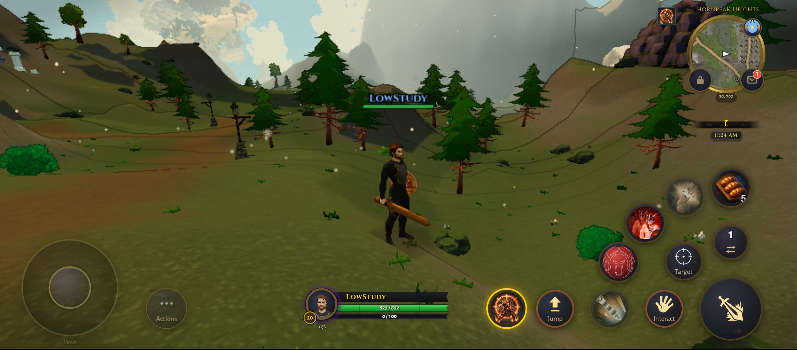
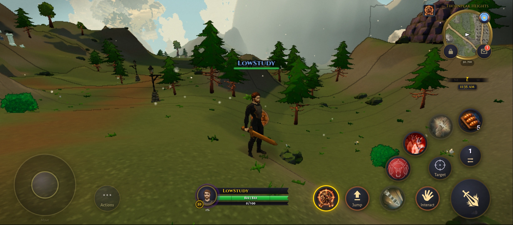
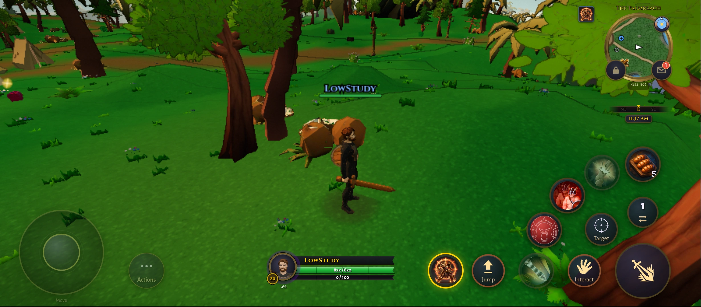
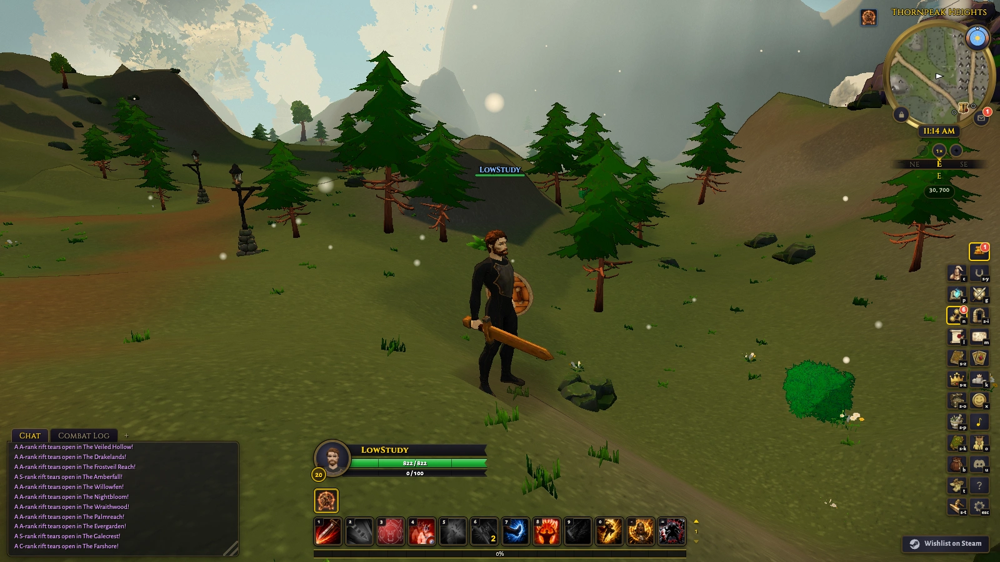
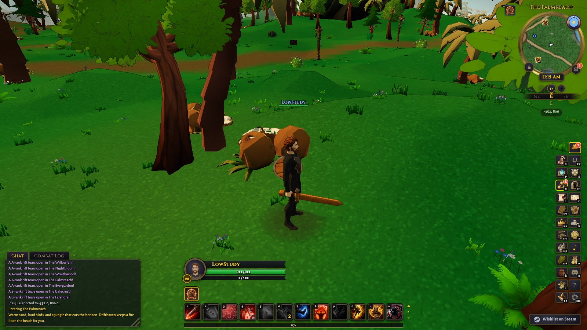
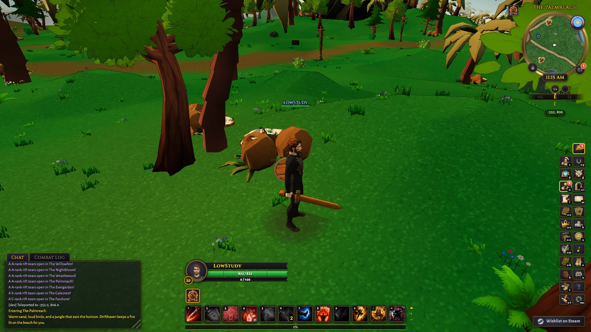
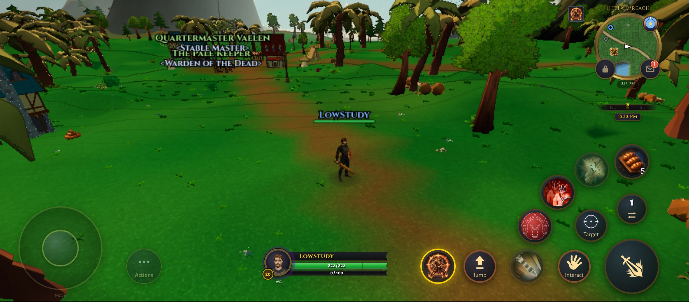
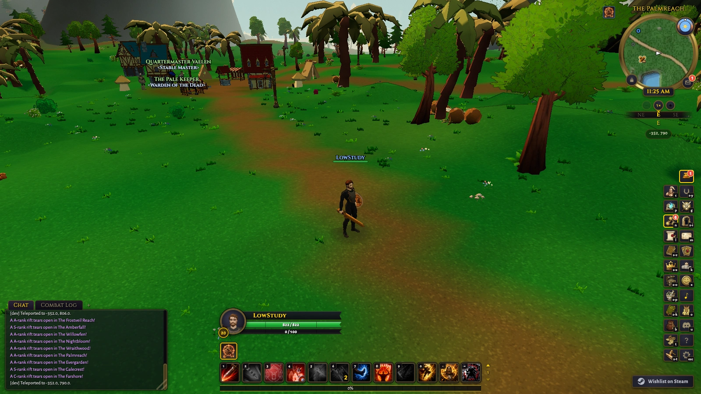

# Low coconut grouping: constructor integration

Retain the integrated 128-yard coconut grouping on Low. Redmi Thornpeak improves from 19.27 to 22.57 FPS and, in reversed order, 19.40 to 22.49 FPS: a repeatable gain of about 3 FPS, exceeding the roughly 10% noise reference in both orders. Model detail, placements and view distance are preserved.

Phone beach changes from 18.88 to 19.30 FPS, then 19.03 to 18.38; neither is a clear gain. Both Mac scenes/orders remain within noise, with no repeatable meaningful desktop regression and no demonstrated desktop speed gain. The 23 FPS experiment target and agreed 60 FPS phone target remain unmet. This validates one local culling improvement, not an optimal overall graphics configuration.

First-use hitch parity is unresolved: the fresh candidate's phone approach reached 281 ms versus 112 ms for a warm control, with additional preparation only in the candidate. Matched cold-entry testing is needed before claiming that this change preserves startup smoothness.

The prior 64-yard live-injection experiment is now integrated at scene construction.
The candidate uses 128-yard cells on Low on both desktop and phone; other tiers keep
one batch. Models, material identity, placements, collision and view distance are
unchanged. There is no extra frame-loop logic or new distance cull.

`buildStaticInstanceCells` reuses `partitionByCell`; `buildJungleFeatures` creates
coconut cells before `attachZoneFeature` gates/freezes/registers the subtree. This
keeps preparation and shadow inventory ownership intact. The jungle view's terminal
dispose releases its instance buffers and rebaked coconut geometry, once, without
disposing borrowed GLB materials. Renderer teardown calls this owner.

Size screening on the earlier identified sprite-v4 build, sprites OFF, was geometry
and draw-count evidence only. 64 and 128 yards each reject 384,264 coconut triangles
in the phone Thornpeak view. Beach extra draws fall from 31 to 10 at 128. 256/512 yards
add fewer draws but submit more offscreen triangles at Thornpeak. The fresh integrated
build has no sprite transform or atlas: both comparison arms use exactly that build,
with `?gfxo=fxaa:0,coconutCellSize:0` versus 128. The only source transform enables
local offline entry. This is not a shipped deployment.

Validation: 36 focused tests across static cells, jungle integration, lifecycle,
existing cell partition, scenery LOD and feature sweep. `npx tsc --noEmit` passed.
Scoped Biome passed with warnings. GPU and frontend/test code reviews found no
blocker; no per-cell first-use upload guarantee is inferred from shader preparation.

`node scripts/gate_select.mjs` passed artifact generation/freshness and the malware
scan (0 high findings), then failed changed-file Biome at the unrelated existing
`src/sim/content/pvp_honor.ts` format issue. Its release-based diff includes 5,504 paths.
The graphics-profile byte-pin test also fails identically on unchanged HEAD, verified
with baseline source/test copies which were removed afterward. No profile pins were
silently rebased. The branch is not certified merge-ready. No unrelated cleanup,
push, merge or deployment is included.

Measurement method: submitted-frame deltas, not browser callback counts. Mac uses
two simultaneous uncapped Metal targets at 1600 by 900, three 20-second windows per
arm/scene, then reversed launch order. Phone uses the physical Redmi at 899 by 394
(CSS 894 by 392), fixed scale 0.68, sequential 0/128/128/0 entries and two 20-second
windows per scene/entry. Compare within each order and scene only. Uptime was
recorded before each entry/run. Both use Low, three-band cel, fixed noon, governor
off and FXAA off. Phone disables shader-corpus recording in both arms; Mac retains
the default auto control in both. These device methods are not interchangeable.

Phone attempts v1 (preparation timeout) and v2 (lost wake helper after the inherited
wake owner exited) contain zero accepted windows and are excluded. V3 resumed the
entered control page after wake recovery; subsequent entries reload. Any late
preparation discards the current accepted block and restarts it after settling.
Raw excluded windows remain beside the accepted data. Cold entry can spend minutes
in background preparation; this change makes no startup-speed claim. Battery
temperature was 35 degrees C at all four entries; this is not GPU thermal telemetry.

Normal-paced approach/retreat/orbit captures are separate from FPS timings. The
warm phone control is reused, while the candidate is freshly entered. First-draw
instrumentation records the first observed cell use after installation; it cannot
isolate instance-buffer upload cost or certify every camera transition. Mac first
approach maximum callback intervals were 40.6 ms control and 37.0 ms candidate.
Shader readiness alone does not prove instance-buffer residency.

Phone first approach maximum callback intervals were 111.6 ms for the warm control
and 280.8 ms for the freshly entered candidate. The candidate completed 74 additional
preparation units and added five programs during this diagnostic; the control added
neither. The largest candidate interval overlaps the first observed cell draws, so
an upload contribution cannot be ruled out, but the unequal preparation/cache state
prevents attributing it to grouping. First-use hitch parity remains unproven; do not
present this as a smoothness win. This diagnostic is excluded from the FPS table.

Visual inspection: matched near/wide Mac and Redmi pictures preserve the coconut
clusters, scenery silhouettes and view distance. Sampled frames from the continuous
phone approach/retreat/orbit recordings show no obvious missing groups. Both routes
travel about 42 yards forward and 27.5 back. No page errors were recorded. The checked
views still have dark clothing and jagged mobile detail, and wide-view NPC nameplates
obscure part of the camp. These captures establish no new visual-quality improvement
or every-frame/no-popping guarantee.

Coverage is bounded to the inspected Mac/Redmi scenes and routes, not Windows,
iPhone, a fully casting online raid, whole-world visuals or precise GPU residency.
The accepted production source hashes are checked against the served minified
build; benchmark instrumentation and offline-entry access remain local research
helpers. This is not a shipping-default or globally optimal-pipeline claim.

Commands and outcomes:

- `npx vitest run tests/static_instance_cells.test.ts tests/jungle_feature_cells.test.ts tests/renderer_resource_lifecycle.test.ts tests/zone_feature_cells_core.test.ts tests/scenery_geometry_lod.test.ts tests/zone_feature_sweep.test.ts`: 36 passed.
- `npx vitest run tests/static_instance_cells.test.ts`: 3 passed again after strengthening independent placement assertions; these are part of the 36, not three extra tests.
- `npx tsc --noEmit`: passed.
- Scoped `npx biome check` on changed TypeScript/test files: passed with non-null-assertion warnings.
- `node tmp/coconut-integration/build.mjs`: minified local offline build passed, all 2,146 media files verified.
- `node scripts/gate_select.mjs`: failed at the existing formatting issue described above; subsequent broad test/browser/build stages not reached.
- `node tmp/coconut-integration/check_baseline.mjs`: unchanged-baseline reproduction of the graphics profile pin failure; temporary probe files removed.

## Measurements

| Device | Scene | Order | Single batch FPS | 128-yard cells FPS |
| --- | --- | --- | ---: | ---: |
| Redmi | thornpeak | baseline-first | 19.27 | 22.57 |
| Redmi | beach | baseline-first | 18.88 | 19.30 |
| Redmi | thornpeak | candidate-first | 19.40 | 22.49 |
| Redmi | beach | candidate-first | 19.03 | 18.38 |
| M4 Pro | thornpeak | baseline-first | 114.18 | 115.08 |
| M4 Pro | beach | baseline-first | 127.67 | 126.77 |
| M4 Pro | thornpeak | candidate-first | 143.20 | 141.46 |
| M4 Pro | beach | candidate-first | 142.02 | 144.41 |

## Matched pictures

| View | Single batch | 128-yard cells |
| --- | --- | --- |
| Redmi Thornpeak |  |  |
| Redmi beach |  |  |
| Mac Thornpeak |  |  |
| Mac beach |  |  |
| Redmi wider beach |  |  |
| Mac wider beach |  |  |

Full local report: `tmp/coconut-integration/report.html`. Raw timings, source/build hashes, exclusions, diagnostic routes and videos are under the same ignored directory and are unavailable in a fresh clone. Production code, regression tests, this record and the matched stills are committed.
