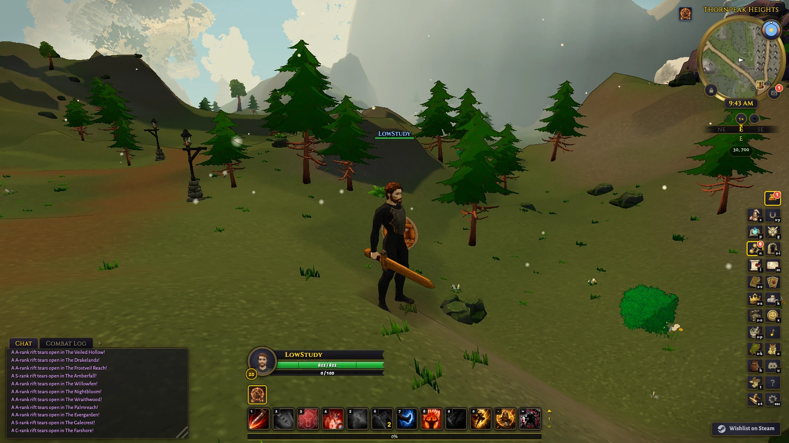
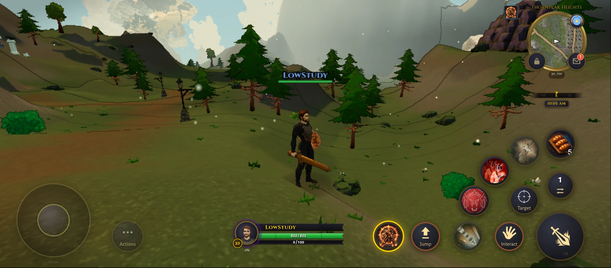
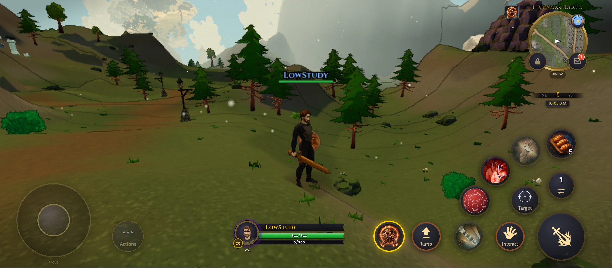
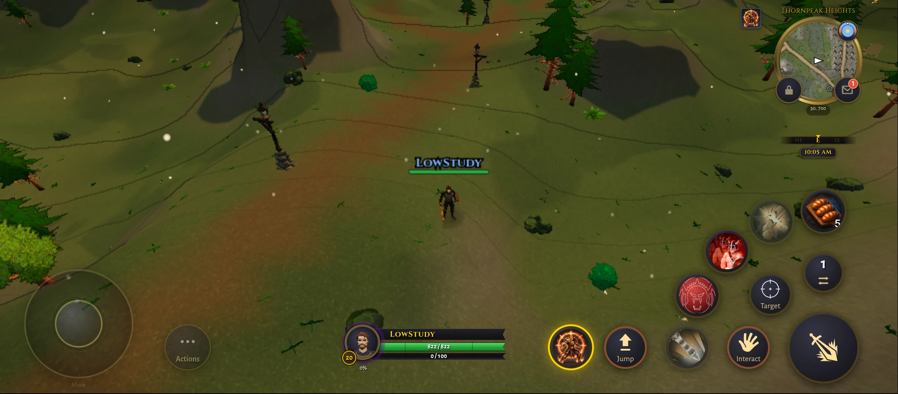
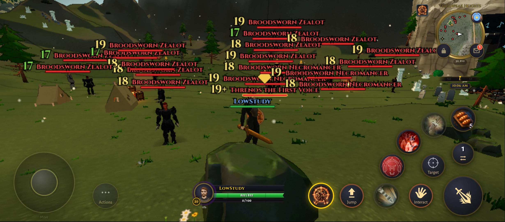
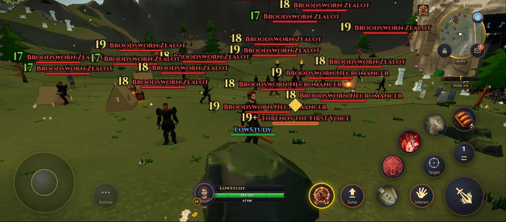

# Distant tree sprites on Low: bounded experiment

Research record, 14 October 2026. Based on local `8ac3ed28f3da` on
`feature/cel-shading-rnd`. No production source or shipping defaults changed.
This is a follow-up to [Low scenery R&D](low-scenery-rnd.md).

## Scope

Reuse `src/render/foliage_impostor.ts` and the existing atlas angle blending.
Replace only core trees beyond 180 yards with Lambert-shaded impostors. Keep
near-fill trees, rocks, bushes, buildings, scenery LOD and lighting unchanged.
Sprites end at the original core-tree boundary; view distance is not reduced.
The OFF control suppresses sprite submissions and restores the original tree
window. Both states retain the atlas and material clones, so these are rendering
comparisons, not memory measurements against an unmodified process.

The build-only experiment lives in `tmp/sprite-experiment/`. Desktop uses build-v2
and the existing 80-pixel atlas cells. Redmi build-v4 keeps its global
constrained-memory profile and allows only this experimental tree atlas, using
64-pixel cells inside 1024 by 1024. The existing packer confirms all 15 tree
variants fit. The RGBA8 atlas plus mip chain is approximately 5.33 MiB, excluding
bake scratch and driver overhead. Original geometry remains resident.

## Method and results

Fixed Low, cel3, noon/camera in Thornpeak, governor off, fixed drawing buffer.
Count submitted frames, exclude preparation, preserve source/build provenance.
Desktop: two concurrent uncapped Metal browsers at 1600 by 900, three 20-second
windows per setting, then reverse launch order. Check uptime before each run.
Phone: single-page ABBA then BAAB, two 20-second windows per setting/order.
Compare only within each row. Approximately 10 percent is the noise reference.

| Device/order | Current Low FPS | Tree sprites FPS |
| --- | ---: | ---: |
| M4 Pro, current Low launched first | 162.20 | 164.56 |
| M4 Pro, sprites launched first | 156.83 | 158.77 |
| Redmi, ABBA | 19.44 | 20.27 |
| Redmi, BAAB | 19.05 | 20.37 |

Desktop submitted triangles fell from approximately 2.064 million to 1.901
million, with 426 to 417 draws. Both orders passed stable-buffer/quality and
preparation checks. This does not establish a meaningful desktop speed gain.

Redmi submitted triangles fell from 2,557,625 to 2,394,926. All eight phone
windows were preparation-free with fixed quality/buffer, visible page and held
wake lock. The tree endpoint stayed 272.5 yards in both states; no view-distance
reduction contributed to the result. The changes are 1.5/1.2 percent on Mac and
4.3/7.0 percent on Redmi, below the roughly 10 percent screening threshold in
both orders. **Do not adopt this configuration for a demonstrated speed gain.**
This result is specific to core trees beyond 180 yards; it does not rule out
impostors for other objects or distances.

Phone preparation outlasted the first wait limit. The continued driver reused
the same loaded page, with no navigation, and began timing only after the queue
was empty. There were no shader/page errors or WebGL context losses in the
accepted phone run. Existing offline API errors remain documented below.

## Visual and restoration checks

The inspected Thornpeak ground-level and elevated pairs remain coherent, with
subtle distant-tree differences and nearby 3D shapes retained. No obvious blank
card or lost tree layer was seen. This is visually plausible, but not a quality
improvement. Dark clothing and mobile jaggedness remain. Camp nameplates obscure
part of the third pair. A recorded approach/retreat/orbit moved the player about
39 yards forward and 28 back; sampled frames retain landmarks. This limited
inspection does not prove every 180-yard transition is imperceptible.

In all three views, actual sprite draws were 0/1/0 for OFF/ON/restored. Visible
near-fill, rock and dressing triangle counts stayed identical across each trio,
and OFF restored the original core-tree counts. Source checks preserve building
and outer-tree limits. Controls are restored to OFF; phone wake protection stays
active under the existing user instruction.

| Scene | Current Low | Tree sprites |
| --- | --- | --- |
| Mac Thornpeak |  |  |
| Redmi Thornpeak |  |  |
| Redmi elevated |  |  |
| Redmi camp, partly obscured |  |  |

## Evidence and limits

Local report: `tmp/sprite-experiment/report.html`. Raw `mac-pair-v2-*.json`,
`phone-v4r1.json`, `phone-v4.json`, build provenance, retained experimental source and drivers live
beside it. The first build was excluded before timing because OFF still
submitted hidden sprite vertices; explicit visibility suppression fixed that.
Phone attempts before v4 contain no accepted timing: preview-restart navigation,
existing memory policy exclusion, and an insufficient atlas packing budget.

Focused control/transform tests pass. The existing packer confirms the capped
atlas inventory. Offline API 502s and missing training-dummy/druid-staff visuals
limit scene coverage; they are not shader errors. No Windows, iPhone, online raid
or sustained whole-world acceptance is implied. The existing branch merge gate
remains incomplete as documented in the Low scenery record.

Validation commands: `node --test tmp/sprite-experiment/control.test.mjs`
(five passed); the existing `packImpostorAtlas` with all shipped tree specs at
64px (fits 1024); minified research builds; `bench_mac_pairs_v2.mjs`,
`bench_phone_v4_resume.mjs`, and `visual_phone_v2.mjs` under the experiment folder.
Static GPU review identified the original OFF-submission defect, fixed before
accepted timing. A documentation-only evidence commit does not clear the prior
branch merge gate.
