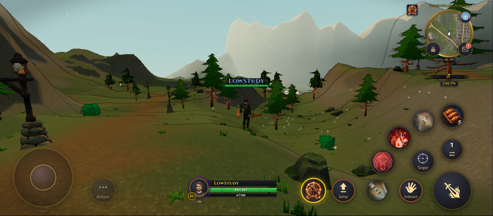
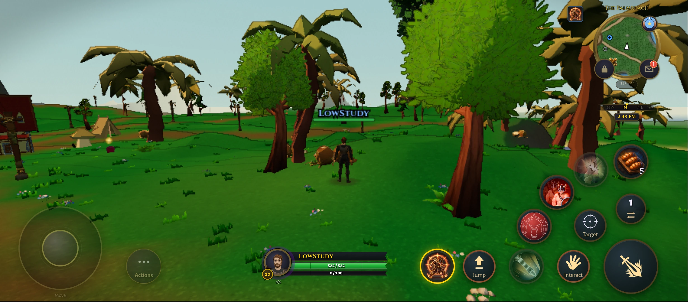
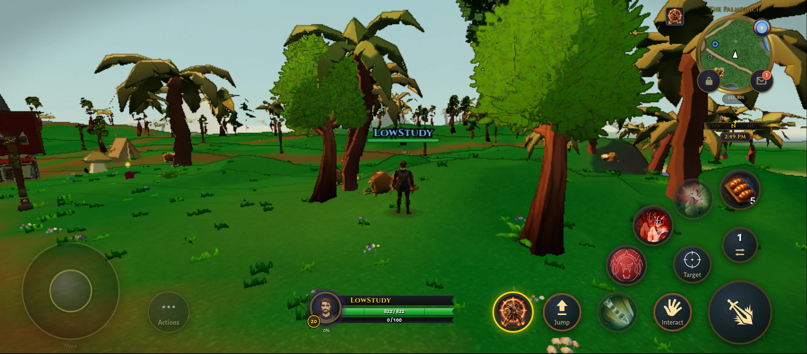
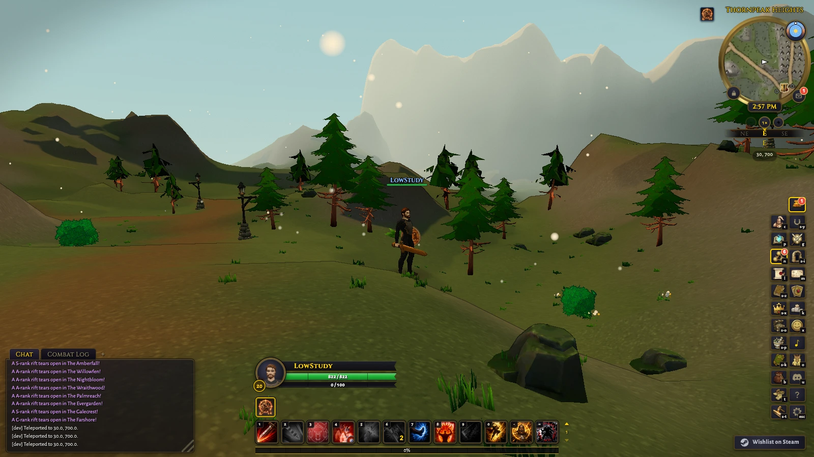
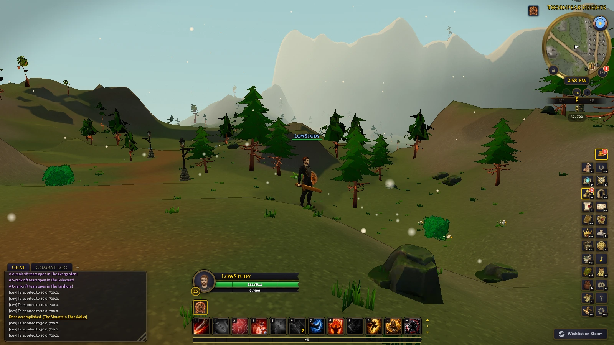
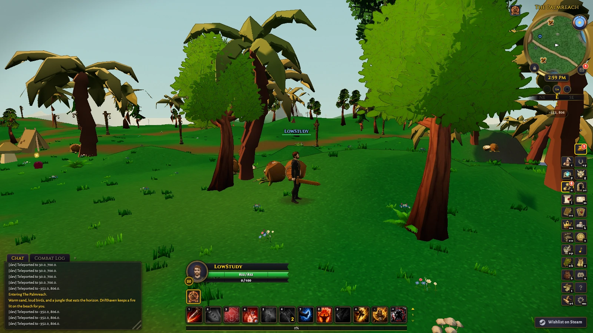
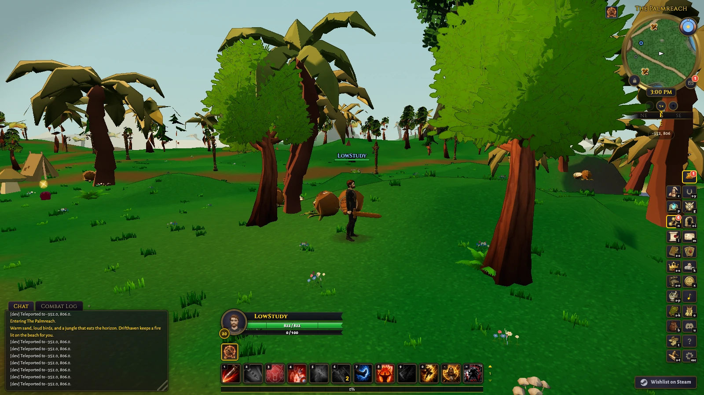

# Low scenery: a cheaper 120 to 240-yard layer

14 October 2026. Local research on `feature/cel-shading-rnd`, following
`middle-band-scenery-rnd.md`. No shipping defaults changed; nothing pushed,
merged or deployed.

## Finding

The 120 to 240-yard scenery layer is affordable in these two warm test scenes, but this model reduction should not ship. With the existing 0 to 120-yard setup fixed, the Redmi measured 42.29 to 42.13 FPS and reversed 43.24 to 42.55 in Thornpeak; Palmreach measured 31.97 to 31.51 and reversed 32.00 to 29.85. One Palmreach candidate window was slower, so do not call the added layer free. Mac paired comparisons lost about 1.2 to 5.9 FPS. None of these aggregate costs exceeds the roughly 10 percent comparison-noise threshold; background simulation jobs also limit desktop precision.

Keep the three distance bands as a promising candidate: full detail to 60 yards, reduced geometry to 120, and very cheap geometry to 240. The next requirement is clean tree silhouettes and transitions. Automatic reduction leaves fragmented canopies even at the far distances; the current visual result is not acceptable final art. This does not establish phone 60 FPS, a production preset, cold-entry performance or whole-world coverage.

## Results

| Device | Scene | Order | 120-yard baseline FPS | Added outer layer FPS | Added placements | Added triangles |
| --- | --- | --- | ---: | ---: | ---: | ---: |
| Redmi | Thornpeak | forward | 42.29 | 42.13 | 232 | 15719 |
| Redmi | Thornpeak | reverse | 43.24 | 42.55 | 232 | 15719 |
| Redmi | Palmreach | forward | 31.97 | 31.51 | 265 | 12912 |
| Redmi | Palmreach | reverse | 32.00 | 29.85 | 265 | 12912 |
| Mac | Thornpeak | forward | 125.83 | 121.91 | 232 | 15719 |
| Mac | Palmreach | forward | 119.04 | 117.85 | 265 | 12912 |
| Mac | Thornpeak | reverse | 104.26 | 98.48 | 232 | 15719 |
| Mac | Palmreach | reverse | 114.18 | 108.30 | 265 | 12912 |

Compare within each row only. The control retains full-detail scenery to 60 yards
and the prior simple 3D representation from 60 to 120 yards. The candidate adds
further reduced eligible scenery from 120 to 240 yards. Neither is stock Low.

Redmi 12 5G, Adreno 613: fixed 899 by 394 buffer at scale 0.68, one warm page,
baseline/candidate then candidate/baseline. M4 Pro: two simultaneous uncapped
ANGLE Metal Chrome targets at 1600 by 900, reversed browser launch order,
uptime recorded before both runs. Other simulation jobs were active on the Mac;
do not interpret small desktop differences as gains. Two 20-second submitted-frame
windows per setting/scene/order. The same unchanged minified game build,
camera/fog, graphics quality and noon lighting were used throughout.

All 32 accepted timing windows were preparation-free and retained their
controls. Independent band membership was checked against the audited camera
matrix and placement origins/bounds. Near source placements remained exact;
the two cheap layers had no overlapping placements in the timed views.

An interrupted pilot charged outer-band selection costs to the hidden baseline.
That pilot is preserved in `tmp/far-band/pilot-shared-selection/` and is not used
in these results. Final code skips far selection entirely on disabled frames;
snapshot audits refresh selection outside measured windows. Both test orders
were restarted with that correction. Any later invalid blocks remain in raw JSON.

## Implementation and limits

`scripts/lib/far_band_experiment.mjs` exports `installFarBandExperiment`, a
research-only controller not imported by the shipping game. Install distance,
then far, then middle; dispose in reverse. Existing controllers are unchanged.

- Collect eligible large foliage trees/rocks and static garden/jungle placements
  and landmarks within 310 yards before source packing. Small clutter,
  towns/buildings, other asset classes and unvisited zones are outside this study.
  No streamed-in inventory refresh; routes stay within the preparation envelope.
- Keep the existing 0 to 120-yard configuration and add a disjoint outer band.
  Foliage uses placement origins; zone scenery uses whole footprints, so named
  distances do not slice through large objects.
- Target 32 triangles per original mesh part, versus 128 for the middle band.
  Meshopt simplification can stop above its target or fall back; actual output
  is recorded in `snapshot.stats` and the submitted outer-layer totals above.
  Preserve placements and source textures, use Lambert lighting, merge by material.
- Compile through the existing GPU gate, then exercise the enabled mode and settle
  before timing. Enabled frames pay selection and movement-triggered index packing;
  disabled frames skip them. These are warm comparisons, not cold-upload/hitch tests.
- Borrow source assets without disposing them. Release owned geometry/materials
  and restore hooks on cleanup and failed preparation. The far layer adds no atlas.
  Both comparison arms retain all research resources, including the middle installer's
  unused sprite atlases. This is not an untouched-process memory comparison.
- Terrain, actors, simulation, lighting, fog and shipping settings are unchanged.
  Sustained combat, broader world/fairness coverage, Windows/iPhone and the phone
  60 FPS target remain unresolved. No final preset or production streaming design.

## Visual judgement

The extra layer fills previously empty ridge and horizon areas with distant trees. In Thornpeak, several ridge-top trees become scattered, floating-looking canopy fragments; Palmreach gains background density but also shows detached-looking crowns and sparse branches. The stronger reduction makes the silhouette problem from the middle-band experiment more apparent. Nearby scenery and terrain retain their existing shapes in the matched views. My judgement: useful evidence that this distance band is affordable, but these automatically decimated far models should not ship. Build simpler, connected canopy shapes that preserve tree outlines, then judge their handoff to the middle models. The screenshots and bounded warm movement clips are visual evidence, not proof of hitch-free streaming or sustained combat performance.

Phone movement covered about 34 to 35 yards in Thornpeak and 18 yards in Palmreach from the first sampled position. The clips also show the existing abrupt detail changes as large scenery crosses distance bands. All phone stills and movement audits retained the 899 by 394 render buffer; recordings are qualitative, not timed FPS samples.

The local report `tmp/far-band/report.html` contains all tables, 16 matched stills
and four phone movement clips. Raw JSON, exact injected source/bundle, source
hashes and audit scripts are in the same ignored directory. A fresh clone receives
the module, tests, this record and eight wide stills below; ignored local evidence
does not travel with a clone.

## Verification

npx vitest run tests/far_band_experiment.test.ts tests/middle_band_experiment.test.ts tests/scenery_distance_experiment.test.ts: 18 tests passed.
npx tsc --noEmit: passed.
npx biome check --write scripts/lib/far_band_experiment.mjs scripts/lib/far_band_experiment.d.mts tests/far_band_experiment.test.ts: passed after formatting.
Scoped GPU producer review, including the disabled-baseline fairness correction: no concrete blocker found.
node scripts/gate_select.mjs: freshness and malware checks passed; stopped on two pre-existing branch Biome errors in src/sim/content/pvp_honor.ts and tests/static_instance_cells.test.ts. Later broad stages were not reached. No merge-readiness claim.
python3 tmp/far-band/accept.py: 32 authoritative timing windows accepted; no rejected final blocks, no page errors, fixed controls, independent far membership, no near omissions. Interrupted pilot retained separately.
Exact timed controller matches final source.
python3 tmp/far-band/visual_accept.py: 16 matched stills, four phone videos, eight bounded movement routes, matching cameras and buffers, no near omissions.
node tmp/far-band/report_check.mjs: all result rows, image selectors and videos present; images load and no page errors or horizontal overflow.

## Matched wide views

### Phone, Thornpeak

### Phone, Palmreach

### Mac, Thornpeak

### Mac, Palmreach

