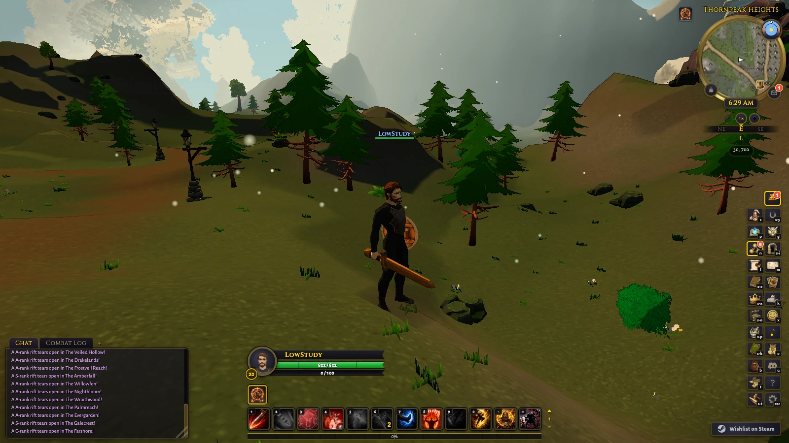
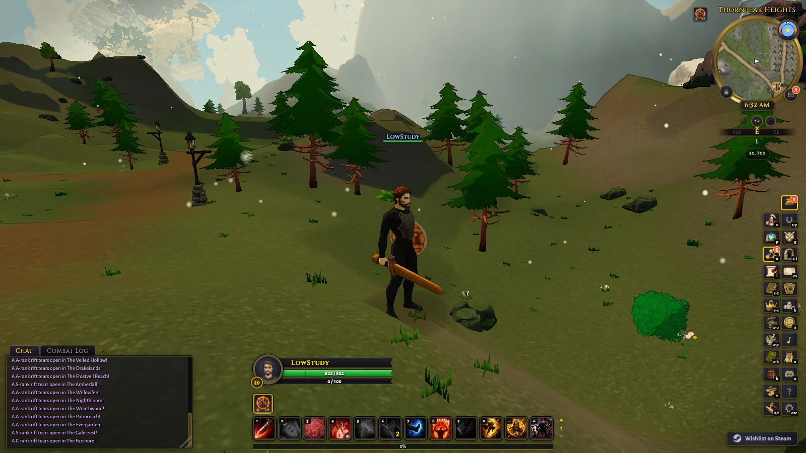
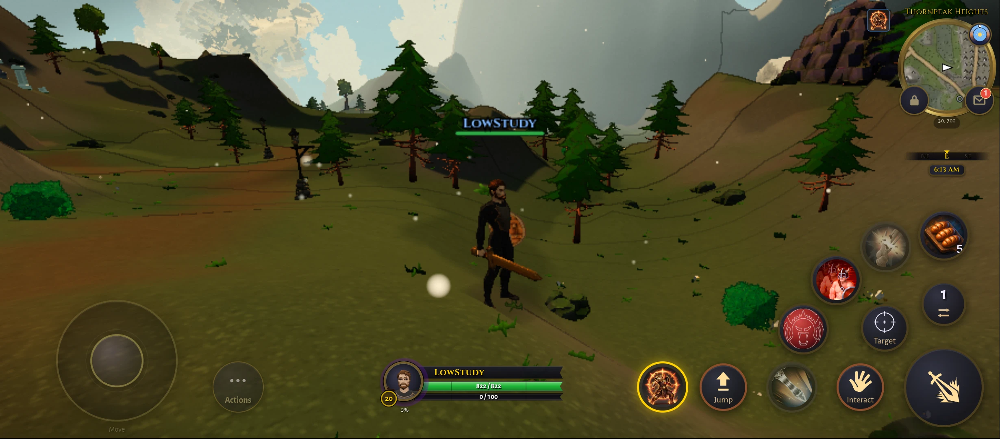
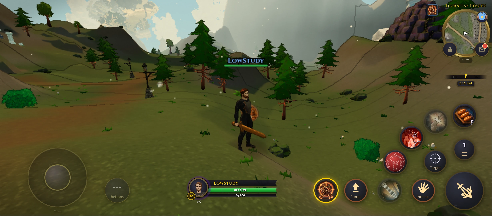
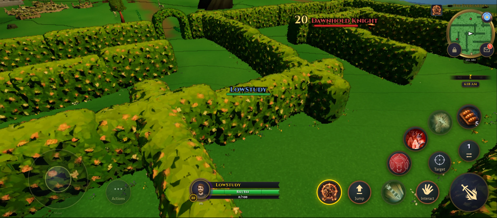
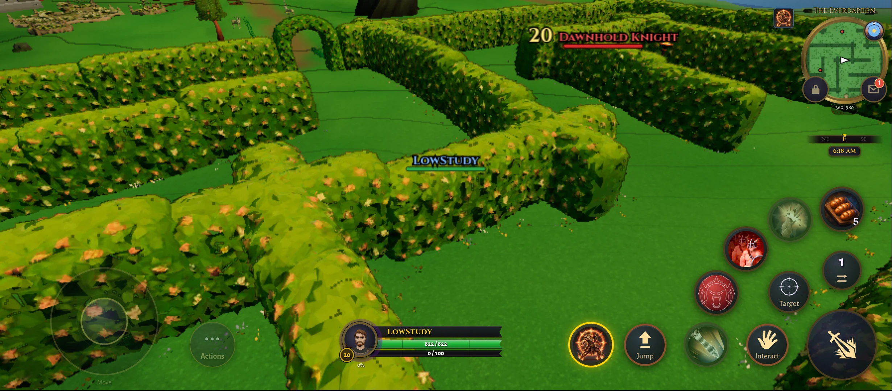
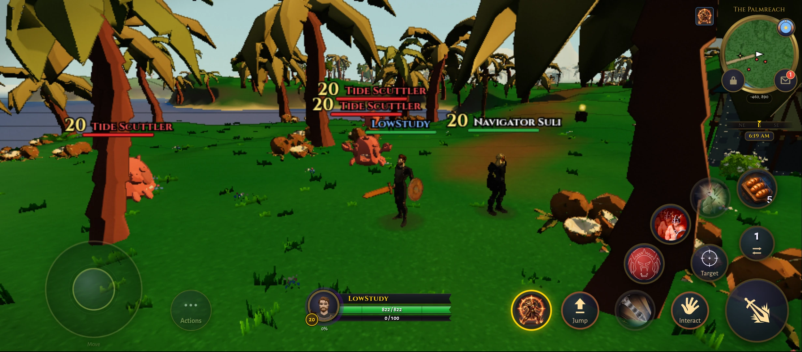
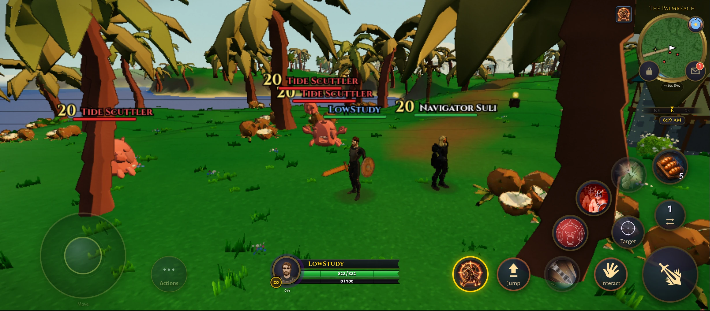

# Low scenery and lighting experiment

Research record, 14 October 2026. The target is clearer Low graphics on desktop
and phone without shortening the visible world or changing gameplay information.
Three-band cel is the visual reference; 60 FPS on both remains the target.

## Implementation

`scenery_geometry_lod.ts` prepares source-owned index variants for static garden
and jungle features, then switches them through the existing
`sweepZoneFeatures` path. Low uses coarse geometry beyond 180 yd from the nearest
XZ footprint edge and restores full detail inside 162 yd. A wide instance batch
stays detailed whenever any part of its bounds is nearby. Medium and above keep
their existing geometry policy and lighting.

`scripts/assets/build_scenery_lod.mjs` derives hedge walls, arches, elder bark
and palms from SHA-pinned source assets using the existing `WOC_lod` extension.
It retains level-zero indices, vertex attributes, materials, textures, node
transforms and scenes. Elder leaves are excluded from simplification. Palm
rebaking carries the index levels through dequantization and transforms with
`carryGeometryLod`. Shared tree/palm consumers load the same derived source while
retaining full geometry where their existing policy requires it.
The derived `<model>_lod` copies are not placeable: `isSceneryLodCopyCatalogId`
(in `scripts/assets/scenery_lod_build.mjs`) keeps them out of the Studio asset
catalog and the collision bake, so an authored map places the source model.

This changes geometry complexity, not view distance, collision or combat cues.
The same Low policy applies on desktop and Android. Low hemisphere fill rises
from 0.9 to 1.8 and directional intensity falls from 2.65 to 2.25, using the same
two lights and shader programs. Higher-tier terrain compensation retains the
legacy constants. Cel itself remains opt-in with `?cel=on&celbands=3`.

Geometry preparation is CPU-only: Three still uploads a new index buffer and
prepares its VAO on first draw. No claim of cost-free first use is made.

## Controlled results

All comparisons below use the same minified v3 research build and a fixed
Thornpeak view at (30, 700), noon, Low, governor off and FXAA off. Submitted
frames are counted, not just animation callbacks. Every accepted window kept
its drawing buffer and quality and performed no background preparation.
Compare within a row only. Absolute values across separate runs are not a
speed comparison. The study uses roughly 10 percent as its noise reference.
The final source bumps the graphics telemetry version to 22; the measured v3
build predates that metadata change. Rendering behavior is unchanged by it.

| Device and comparison | Order | Original FPS | Candidate FPS |
|---|---|---:|---:|
| Redmi, cel on both, same page | ABBA | 16.86 | 19.41 |
| Redmi, cel on both, same page | BAAB | 16.83 | 19.38 |
| Mac, cel on both, two concurrent browsers | Original first | 158.78 | 148.36 |
| Mac, cel on both, two concurrent browsers | Candidate first | 156.45 | 148.54 |
| Mac, cel on both, single browser | ABBA | 208.89 | 211.20 |
| Mac, cel on both, single browser | BAAB | 211.35 | 213.12 |
| Mac, stock look versus cel candidate, two browsers | Stock first | 180.22 | 169.97 |
| Mac, stock look versus cel candidate, two browsers | Candidate first | 140.00 | 131.59 |

Redmi 12 5G: Adreno 613, Chrome 154, render scale 0.68, 899x394 drawing buffer
and 894x392 CSS viewport. Eight 20-second windows, ABBA then BAAB. Submitted
triangles in the fixed view fell from 3,302,758 to 2,557,625 without fewer draws.
The phone gain repeats in both orders but remains far short of 60 FPS.

Mac M4 Pro: uncapped ANGLE Metal, 1600x900, DPR 1, render scale 1. Paired runs
use three concurrent 20-second windows per browser, then reverse launch order.
The single-browser check uses eight windows on one page. It does not reproduce
the paired slowdown, but its gain is within noise. The cause of the paired
difference is unproved. **No meaningful desktop speed gain is established.**

In the cel-on comparisons, both sides use ink 0.5, ink width 0.65, mid 0.65 and
saturation 1.05. Original scenery/light uses
`gfxo=fxaa:0,sceneryGeometryLodDistance:0,lowReadabilityLighting:0`; the candidate
uses `gfxo=fxaa:0`. The full stock-look comparison additionally disables cel on
the original side, so it does not isolate scenery cost.

## Visual evidence

Matched stills show a modest lighting lift, with no obvious loss of distant
landmarks in these views. Dark clothing remains hard to read. A follow-up physical-phone material census found the visible body clothing and
merged chest use Lambert materials with white base color and an atlas-scaled
0.045 emissive contribution. Increasing light cannot add contrast to black
atlas texels; this identifies a material/texture lead, not a validated fix.
A temporary body-only replacement with uniform emissive values 0.0075 and
0.015 slightly lifted the silhouette but did not restore convincing garment
detail in the inspected view. Original materials were restored; this probe
is not included in production code and makes no performance claim.
Nearby hedge and palm geometry is unchanged. The garden camera occludes the player behind a
hedge in both states; that pose cannot establish character readability.

| Scene | Original scenery/light | Candidate |
|---|---|---|
| Desktop Thornpeak |  |  |
| Redmi Thornpeak |  |  |
| Redmi Evergarden |  |  |
| Redmi Palmstrand |  |  |

An in-game census verified the original index counts and material identities
for nearby hedge batches and all three palm variants, with distant geometry
swaps active at Thornpeak. Keyboard movement was exercised in these scenes.
These checks do not establish whole-world visual quality or invisible LOD
transitions at every camera angle.

## Existing work and verification

The study reviewed madmatah's recent PR titles before proposing new work. It
reuses the existing geometry-LOD ownership, instancing, source loading and
zone-feature sweep mechanisms. It does not introduce another GPU work queue,
material family or rendering pass.

Upstream PR4227 was evaluated separately on the Redmi. Its retained shader
handles reduced eight-program source-read batches from 125.1 to 173.1 ms to
0 to 0.5 ms, with identical shader text and index-zero attribute names in both
orders. This is a preparation-hitch result, not an FPS improvement; this change
does not port or duplicate that upstream fix.

Behavior and asset contracts live in `tests/scenery_geometry_lod.test.ts`,
`tests/scenery_lod_assets.test.ts`, `tests/zone_feature_sweep.test.ts`,
`tests/outdoor_light_rig_core.test.ts` and `tests/gfx_override_core.test.ts`.
They cover source immutability, near restoration, hysteresis, wide-batch
protection, quantized palm rebaking, deterministic asset generation, unchanged
near appearance and the Low-only profile. Focused tests, TypeScript and the
minified research build passed. Scoped GPU review found no correctness blocker.

Practice boss and crypt entry were exercised on the phone, with no page errors
or context loss. This fixture has stationary allies, not a fully casting online
raid. Background preparation was active. The governor changed quality after
crypt entry, so that window is not fixed-quality performance evidence.

Both candidate-only 30-minute tours completed with normal browser presentation,
explicit 60 FPS intent and the adaptive governor enabled. Each alternated
Thornpeak and town every five minutes, with 30 seconds orbiting and 30 seconds
stationary per minute. These are not paired savings measurements.

| Device | Thornpeak stationary | Thornpeak orbit | Town stationary | Town orbit |
|---|---:|---:|---:|---:|
| Redmi, 899x394 buffer | 20.69 | 23.26 | 36.97 | 33.21 |
| Mac, 1920x1080 buffer | 57.44 | 57.60 | 57.96 | 57.98 |

Each device retained buffer and quality within all 60 windows, with no page
errors or context losses. The phone recorded no wake-lock releases and kept its
lock after test cleanup. Background preparation was absent in 49 phone and 45
Mac windows. These values count submitted game frames, not display scanout.
Late phone samples had multiple submissions between timing-observer callbacks;
the observer's long gaps cannot establish individual frame-presentation times.
The final town screenshots on both devices are partly blocked by a nearby tree
and provide limited character-readability evidence. No thermal cause is proved.

The required selective contribution gate used an 8 GiB Node heap and two
workers after both timed tours exited. Freshness, malware and changed-file
formatting passed. The merged tests reported failures, including omitted
sparse-checkout fixtures and untouched systems, before Reuben requested a
travel pause. The run was deliberately interrupted. On resuming, a bounded
four-suite triage reproduced seven failures: three missing sparse-checkout
fixture/corpus checks and four weapon-aura prewarm signature failures. The aura
failures also reproduced with the modified source modules loaded from the
pre-prototype HEAD, with module caching disabled. They are not introduced by
this scenery change. Other partial-gate failures remain unclassified; no broad
baseline cleanup was attempted. This is not a passing contribution gate.

Resume verification passed `npm run check:types` (game, admin and bot),
`npm run build:env`, `npm run build:server`, `npm run build:bot`, and
`npm run test:browser -- tests/browser/post_cel_depth.browser.test.ts
tests/browser/cel_shading.browser.test.ts
tests/browser/point_light_loop.browser.test.ts` (12 tests). The client research
build and focused source tests had already passed before the telemetry-only
version bump; the full browser suite and final standard client bundle were not
run. Detailed triage logs and its baseline-source config are retained beside
the report. These scoped checks do not replace the incomplete merge gate.

Windows, iPhone, whole-world visual coverage and an active online raid are
unverified. This is a bounded local prototype, not a claim of an optimal
pipeline or a shipping recommendation.

Raw windows, build/source hashes, methods and the detailed HTML report are
local ignored artifacts under `tmp/low-preset/` in `wt-cel-shading`.
`report-v3.html` links the evidence, including failed measurement attempts and
their corrections. Those local artifacts are not included in a fresh clone.
