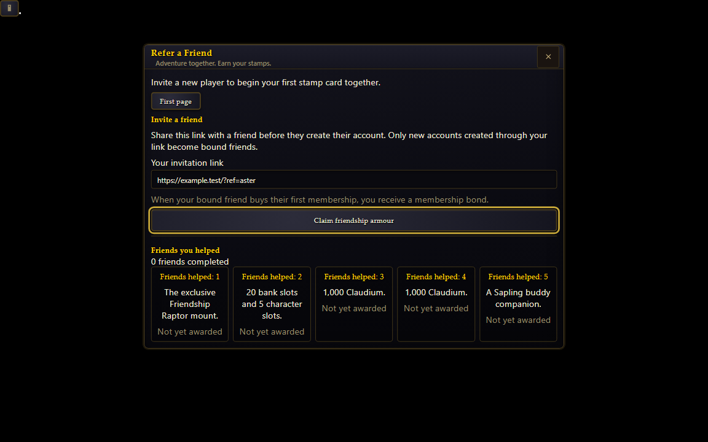
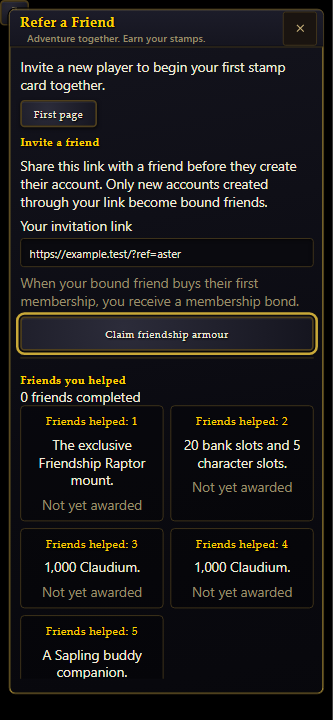
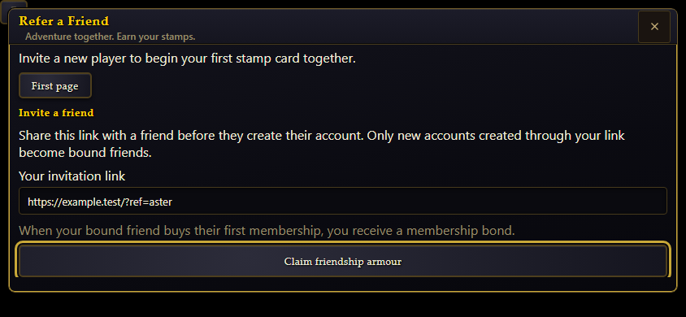
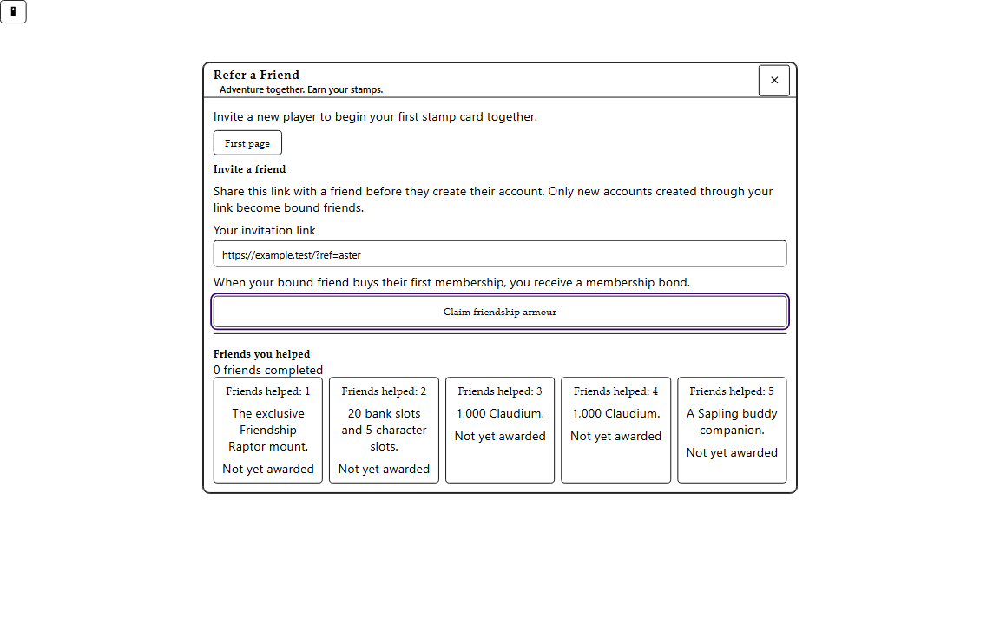
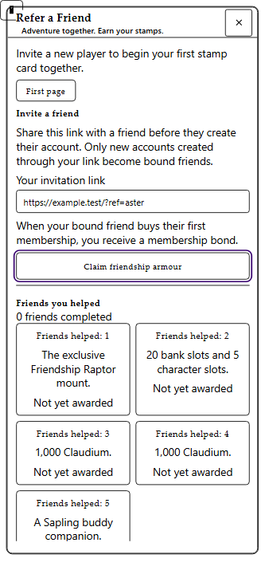
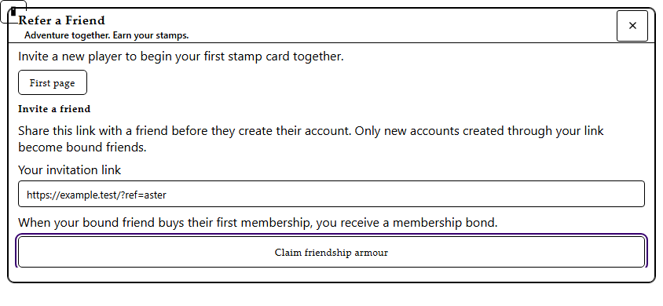

# Membership referral armour

A new account registering through a player-card referral link receives the
Friendship armour entitlement if the inviter has verified active membership at
registration. The existing first referral wins. Legacy referrals are not
retroactively eligible; their historical membership state is unknown.

Every character on the referred account can claim the seven soulbound pieces.
Initial admission grants missing pieces automatically. Full bags allow a partial grant.
Stamp card menu (Refer a Friend) > Claim friendship armour is the manual recovery action for missing
pieces, using `createFriendshipArmourClaim`. The shared bank only offers membership
gear recovery. Referral-screen wiring lives on the integration branch alongside
that screen; the membership PR supplies the reusable control without importing
the stamp-card feature. Claims never
duplicate pieces already in equipment, bags (including overflow), bank or courier
custody.

Claim-location validation on membership PR #4281 (2026-10-14):

- `node node_modules/vitest/vitest.mjs run tests/friendship_armour_claim.test.ts tests/account_bank_window.test.ts tests/architecture.test.ts --maxWorkers=1`: 123 passed.
- `node node_modules/vitest/vitest.mjs run --config vitest.browser.config.ts tests/browser/referral_armour.browser.test.ts`: three viewport cases passed after enforcing a 40px claim target.
- `node node_modules/@typescript/native/bin/tsc --noEmit`: passed.
- Scoped Biome over the changed source/tests passed; `git diff --check` passed.
- `GATE_SELECT_BASE=25d238d80f55d85f4a95b0a57653139430fd3e43 GATE_MAX_WORKERS=1 node scripts/gate_select.mjs`: generation, freshness, SFX and security passed. The broad test phase was interrupted before a verdict to continue integration verification; this is not a green merge gate. The earlier Windows path failure documented in [PR #4281's refinement evidence](https://github.com/levy-street/world-of-claudecraft/blob/b73ea4d6b364ac76257c38c81a3fc72d6abb2b3e/docs/design/membership-refinements-verification.md) remains unresolved.

The standalone browser control fixture verifies semantics and target size, not
the destination screen. Integration carries the actual Refer a Friend wiring
and its screen-level verification separately.

Stamp-menu integration validation on PR #4423 (2026-10-14), based on
`4a366b29899221e17e2c1851611e3bcd1251e038`:

- `node node_modules/vitest/vitest.mjs run tests/friendship_referral_screen.test.ts tests/referral_cards_controller.test.ts tests/account_bank_window.test.ts tests/friendship_armour_claim.test.ts --maxWorkers=1`: 37 passed.
- `node node_modules/@typescript/native/bin/tsc --noEmit`: passed.
- `node node_modules/vitest/vitest.mjs run --config vitest.browser.config.ts tests/browser/friendship_referral_screen.browser.test.ts`: three viewport cases passed, covering keyboard activation, focus after repaint, 40px targets and viewport bounds.
- The same browser file passed all three cases with Playwright context `forcedColors: 'active'` through the local `tmp/courier-forced.browser.config.ts` wrapper.
- Scoped Biome passed; `git diff --check` passed. Frontend and test-coverage reviews found no actionable issues.
- `GATE_SELECT_BASE=4a366b29899221e17e2c1851611e3bcd1251e038 GATE_MAX_WORKERS=1 node scripts/gate_select.mjs`: generation/freshness, SFX, security and changed-file lint passed. The broader test phase has not produced a complete passing result. This change is not certified merge-ready by the full repository gate.

The actual shipping stamp-menu component was visually inspected at desktop,
portrait and landscape sizes, including visible focus in forced colors. These
are component fixtures, not multiplayer-world captures:

| Desktop | Portrait | Landscape |
|---|---|---|
|  |  |  |

| Forced colors desktop | Forced colors portrait | Forced colors landscape |
|---|---|---|
|  |  |  |

The set uses the membership armour class/specialization budget, scales with the
wearer's level, and perfects at level 20 into item level 25. The friend does not
need a membership. Stats remain available when the inviter's membership expires
or the players leave their party. Existing account-deletion cascades still remove
the referral relationship; this grant is not retained after inviter deletion.

Wearing all seven Friendship pieces grants 20% additional experience only while
the specific inviter's account has a character in the same party or raid with
active membership. Any character on that account qualifies. There is no extra
distance or alive-state requirement. The existing linkdead grace period retains
party membership. Leaving the party, removing a piece, or membership expiry stops
the bonus. Membership and Friendship set XP bonuses do not stack.

Tooltips name the inviting character recorded at signup. Renames do not change
the account-based check. Inviter and recipient account IDs are host-only; the
wire carries only the bounded display name. Saved items or forged character
fields cannot establish entitlement.

## Storage and execution

`referral_armour_db.ts` adds two defaulted columns to the existing account-bounded
referral row. First-insert conflict handling preserves attribution, eligibility
and display name. Both registration dispatch paths await best-effort capture
before returning credentials. Failed capture still allows registration under
the existing referral failure policy; no unverified eligibility is granted.

Fresh admission performs one referee-primary-key read before acquiring the
character lease. Resume, XP awards, party changes, saves and ticks add no SQL.
XP checks read seven slots and at most nine other party members, never the realm
roster. The display name uses existing cached identity serialization.

Seven distinct project-generated icons ship at 128px WebP. Exact prompts,
processing, original/master/shipping hashes and visual review evidence live in
`docs/achievements/referral-items-2026-10-07/accepted-art.json`.
