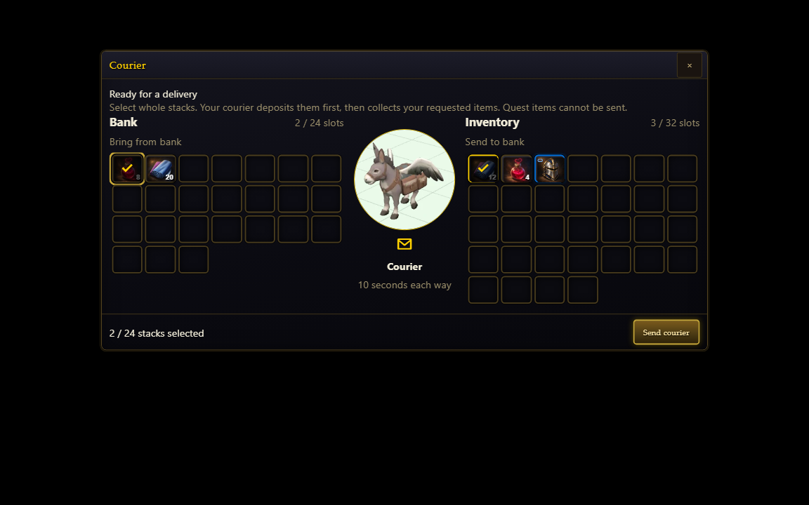
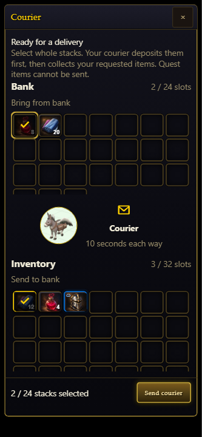
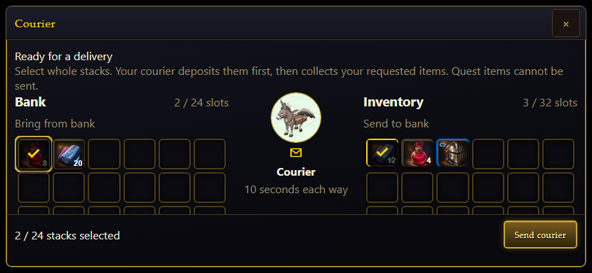
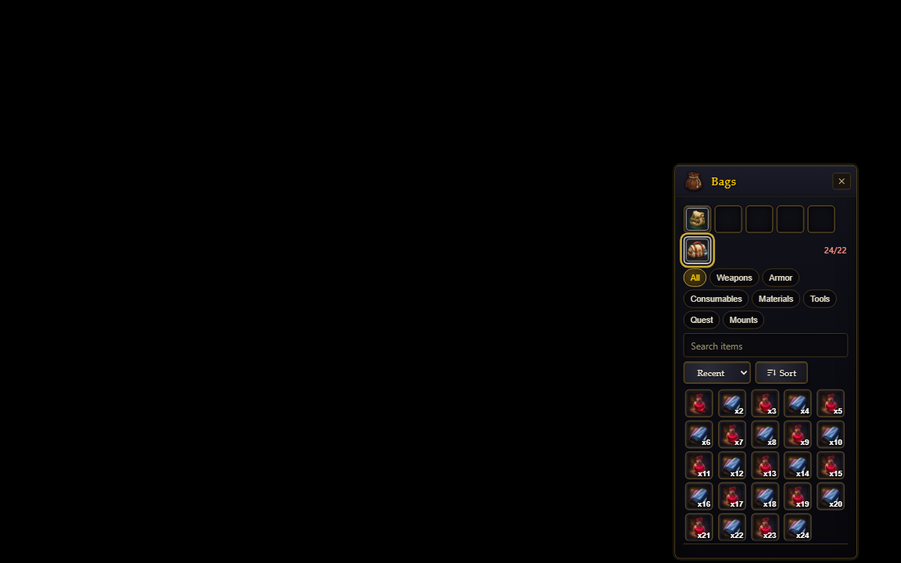
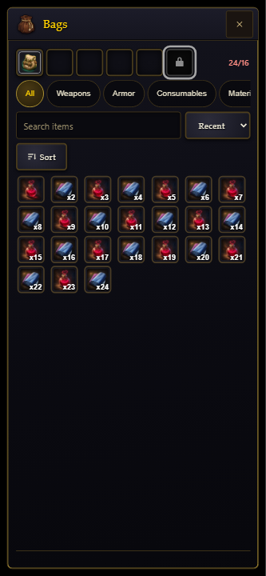

# Membership refinements verification (2026-10-14)

This record covers the changes after PR head
`6c727361910f65e10699dad6d53026bc83d26c93`.

## Behavior and visual evidence

- Membership and Friendship armour are Rare and always character level +5.
  The membership-only Staff of Changing projects class/spec weapon stats and
  held models while retaining one soulbound item identity.
- Claims check equipment, inventory including overflow, bank and courier cargo.
  Missing pieces and membership tokens can enter inventory overflow. Token mail
  and auction transfers retain their instance and custody rules.
- The fifth equipped bag socket is available during membership. Expiry preserves
  the bag and its contents; excess items remain accessible as inventory overflow.
- Courier legs take 200 simulation ticks (10 seconds), with acceleration and
  deceleration, ground takeoff/landing and a direct route. Arrival returns cargo
  into normal stacks or overflow and removes the courier until summoned again.
  Existing logout, death/private-instance and audit-admission pauses remain.
- The bank/inventory courier view has a central donkey portrait and pinned send
  controls. Desktop, portrait, landscape, keyboard focus and forced colors were
  exercised in Chromium. These are shipping-component fixtures, not live realm
  captures.

| Courier desktop | Courier portrait | Courier landscape |
|---|---|---|
|  |  |  |

| Active member bag | Locked member bag with overflow |
|---|---|
|  |  |

The supplied compressed donkey GLB remains 290,048 bytes (283.25 KiB). The new
UI portrait is 7,260 bytes; the Staff of Changing icon is 1,978 bytes. Staff art
provenance and small-size review are in
`docs/achievements/membership-weapon-2026-10-14/`.

## Focused checks

Commands run from the task worktree:

- `node node_modules/vitest/vitest.mjs run tests/membership_armour.test.ts tests/referral_armour.test.ts tests/membership_weapon.test.ts tests/membership_item_tooltip.test.ts tests/membership_bag_slot.test.ts tests/membership_bag_socket.test.ts tests/membership_token_mail.test.ts tests/membership_token_market.test.ts tests/server/membership_game_redemption.test.ts tests/courier.test.ts tests/courier_motion.test.ts tests/courier_wire.test.ts tests/courier_server.test.ts tests/courier_integration.test.ts tests/courier_visual_core.test.ts tests/courier_visual.test.ts tests/membership_abilities.test.ts tests/architecture.test.ts tests/monolith_budget.test.ts tests/item_icons.test.ts tests/weapon_icons.test.ts --maxWorkers=1 --testTimeout=120000 --hookTimeout=120000`: 20 files and 254 tests passed; the architecture worker exited before running under host memory pressure.
- `node node_modules/vitest/vitest.mjs run tests/architecture.test.ts tests/membership_gear_presentation.test.ts tests/server/characters.test.ts tests/action_bar_secondary_requirements.test.ts tests/courier_wire.test.ts tests/courier_server.test.ts --maxWorkers=1 --testTimeout=120000 --hookTimeout=120000 --reporter=verbose`: 310 tests passed, two architecture naming assertions failed. The helper was renamed to `worn_item_definition_core.ts` and its imports/registry updated.
- `node node_modules/vitest/vitest.mjs run tests/architecture.test.ts tests/membership_gear_presentation.test.ts --maxWorkers=1 --testTimeout=120000 --hookTimeout=120000`: final repair verification passed both files and all 118 tests.
- `node node_modules/@typescript/native/bin/tsc --noEmit`: passed.
- `node scripts/ci_changed.mjs`: passed across 245 changed files; existing warnings remain.
- `node scripts/malware_scan.mjs --gate`: passed, zero high findings after repository priors.
- `npm run i18n:gen`, `npm run wiki:content`, and `git diff --check`: passed.
- Chromium courier component: three viewport cases passed; the initial run hung during cleanup and was stopped after the test verdict. The forced-colors rerun passed all three cases with exit 0.
- Chromium bag component: active/locked membership at desktop and portrait, all four cases passed with exit 0, including 24 visible overflow stacks.

## Repository gate

`GATE_SELECT_BASE=6c727361910f65e10699dad6d53026bc83d26c93 GATE_MAX_WORKERS=2 node scripts/gate_select.mjs`
passed preflights, generation/freshness, SFX, security and changed-file lint. Its
first broad Vitest batch found two stale bag-window source anchors and a Windows
path assumption in `tests/active_kit_prewarm.test.ts`. The run was stopped after
these failures; it is not a green repository gate.

The bag anchors were updated to follow the existing extracted undock helper and
the four normal sockets plus separate member socket. A new rendered assertion
also checks the member materials-bag accessible label. Final rerun:

`node node_modules/vitest/vitest.mjs run tests/bags_window.test.ts tests/bank_window_lifecycle.test.ts tests/active_kit_prewarm.test.ts tests/snapshots.test.ts --maxWorkers=1 --testTimeout=120000 --hookTimeout=120000`

Three files passed; 357 tests passed and one failed. The only failure reproduces
in the unchanged `active_kit_prewarm` test: it expects `ability_vfx/fx.ts:1393` but
Windows returns `ability_vfx\\fx.ts:1393`. Both that test and the inspected drawer
are unchanged from the previous PR head. Snapshot key inventory, courier progress
round trips, all bag tests and lifecycle behavior passed. A complete green merge
gate remains required.

The remaining production/type steps were run separately with
`node_modules/.bin/turbo.cmd run check:types build:env build:server build:bot build:bundle`:
all seven tasks passed, including game/admin/bot type checks and client/server/bot
builds. Turbo printed its successful seven-task summary but remained open during
cleanup and was stopped afterward; this is a task-result verdict, not a clean
process-exit claim. `node node_modules/@biomejs/biome/bin/biome ci tests/bags_window.test.ts`
also passed after the final test-anchor repair.

The first pre-push check passed type/guard checks, then caught formatting in the
two newly added JSON evidence files. The repository formatter corrected those
files before the push was retried.

## Performance and rollout

Database-performance, server hot-path, security/persistence, coverage and frontend
reviews were completed and their findings addressed. No SQL/schema changes were
needed. The 400-broadcast grown-bank regression passed with no motion-triggered
heavy bank rebuilds. Ordinary active membership refreshes perform zero owned-item
scans; an explicit repair claim scans each owned storage once.

Component timing evidence is in
[membership-refinements-performance.json](membership-refinements-performance.json).
It uses 1,000 inventory and 1,000 bank entries; its quantiles describe batched means,
not individual production tail latency. Return timing excludes downstream quest
processing and networking.

The courier's old strict pose object is unchanged on the wire. New progress travels
as the separately validated, optional `self.courierTravelTicks` scalar, preserving
old-client compatibility and heavy-payload revision gating.

Drain old character writers before enabling the fifth bag socket. Old serializers
do not preserve the new saved `membershipBag` field; rollback needs a version that
retains that field. Existing courier custody has the same forward-only caveat.
Billing remains disabled by default and requires its separately reviewed companion
service before activation.
