# Low scenery: middle-distance representation experiment

14 October 2026. Local research on `feature/cel-shading-rnd`, following
`aggressive-scenery-distance-rnd.md`. Shipping defaults are unchanged. Nothing
pushed, merged or deployed.

## Decision

A cheap middle-distance layer is viable in these sampled scenes. Simple 3D restores scenery between 60 and 120 yards while keeping Redmi Thornpeak at 43.75 / 43.05 FPS, versus cutoff controls of 44.66 / 44.12. Palmreach reaches 34.54 / 34.53, versus 35.25 / 34.57. Sprites reach 41.78 / 40.42 and 33.88 / 33.94 respectively. The differences remain within the roughly 10 percent comparison-noise threshold, and neither representation has a repeatable meaningful Mac penalty. Sprites show no demonstrated performance advantage over simple 3D.

The visual result does not select a shipping preset: automatic mesh reduction leaves ragged, thin canopies; sprites preserve fuller silhouettes but look flat and have conspicuous lighting differences, particularly on palms. My next candidate would be silhouette-preserving coarse 3D canopies, retaining sprites as a comparison. Keep the aggressive distance budget. Do not restore distant full-detail scenery by default. Phone 60 FPS remains unmet.

## Results

| Device | Scene | Order | Candidate | Cutoff FPS | Candidate FPS |
| --- | --- | --- | --- | ---: | ---: |
| Redmi | Thornpeak | forward | simple | 44.66 | 43.75 |
| Redmi | Thornpeak | forward | sprites | 44.66 | 41.78 |
| Redmi | Thornpeak | reverse | sprites | 44.12 | 40.42 |
| Redmi | Thornpeak | reverse | simple | 44.12 | 43.05 |
| Redmi | Palmreach | forward | simple | 35.25 | 34.54 |
| Redmi | Palmreach | forward | sprites | 35.25 | 33.88 |
| Redmi | Palmreach | reverse | sprites | 34.57 | 33.94 |
| Redmi | Palmreach | reverse | simple | 34.57 | 34.53 |
| Mac | Thornpeak | forward | simple | 163.51 | 168.95 |
| Mac | Thornpeak | forward | sprites | 147.86 | 152.46 |
| Mac | Palmreach | forward | simple | 149.63 | 152.82 |
| Mac | Palmreach | forward | sprites | 163.86 | 166.57 |
| Mac | Thornpeak | reverse | sprites | 114.83 | 112.86 |
| Mac | Thornpeak | reverse | simple | 120.98 | 119.85 |
| Mac | Palmreach | reverse | sprites | 187.88 | 187.86 |
| Mac | Palmreach | reverse | simple | 143.10 | 143.25 |

Compare within each row only. Current comparison baseline is the aggressive
60-yard cutoff, not stock Low. All arms retain both prepared representations
and sprite atlases. These are rendering comparisons, not untouched-process
memory comparisons.

Redmi 12 5G (Adreno 613): 899 by 394 render buffer, scale 0.68; cutoff/simple/sprites,
then reversed order, on one warm page. M4 Pro: two simultaneous uncapped ANGLE
Metal Chrome targets at 1600 by 900; reversed browser launch and candidate order,
with uptime recorded before each run. Two 20-second windows per setting/pair and
scene. Actual submitted frames; fixed quality, camera and fog. The
`tmp/middle-band/accept.py` audit accepted 56 windows with no pending
preparation, changing program count, quality/buffer drift or nearby placement
omissions. Both candidates select the same source population.

The phone debugging transport disconnected during Palmreach preparation after
all Thornpeak timings completed. The wake owner recovered its endpoint. The
same live page was confirmed and Palmreach was freshly prepared before its
first accepted timing. Evidence is retained, not silently replaced.

## Prototype

`scripts/lib/middle_band_experiment.mjs` installs through the existing renderer
and distance-study seams. It is never imported by the shipping game. The shared
distance controller's read-only `retains` query avoids copying its full audit
snapshot on each frame.

- Near scenery stays under the 60-yard distance controller. Proxies fill the band
  to 120 yards, following full-footprint plus 4-yard-margin decisions for zone
  scenery and the existing origin-distance rule for foliage. They do not cut
  through large objects at an exact circular plane.
- The same eligible large foliage trees/rocks, static garden/jungle instances
  and landmarks appear in both candidates. Small dressing remains absent.
  Buildings/towns and other zones are outside this experiment's asset coverage.
- Simple 3D aggressively targets 128 triangles per original mesh part using
  MeshoptSimplifier, retaining placements/textures and using static Lambert
  lighting. It merges parts by material. This is automatic geometric reduction,
  not a manually authored final LOD asset.
- Sprites bake full source placements into four yaw views, 64 pixels per view,
  inside 1024-pixel atlases. Cards use alpha testing and a fixed upright lighting
  normal. No wind or smooth angle blending. The per-placement bake duplicates
  species data; atlas allocation is explicit in the raw inventories and excludes
  depth storage. This prototype is not an accepted production memory budget.
- Both candidates go through the renderer's compile/upload/touch gate before
  scene attachment. The rig exercises both modes and settles before timing.
  Failed bake state restores in `finally`; disposal releases owned resources
  and restores hooks without disposing borrowed source textures/materials.
- Terrain, actors, combat effects and simulation/collision are unchanged.
  Nearby source-placement audits passed. This is not whole-world PvP/fairness
  certification.

## Visual findings and limits

Both candidates restore middle-distance tree density in the matched scenes. The timed Thornpeak view selects 43 foliage placements; Palmreach selects 90 placements (47 foliage, 42 jungle instances and one landmark). More distant Evergarden landmarks remain outside the 120-yard budget; this experiment does not quietly restore them. Nearby scenery and characters remain readable in inspected views.

Simple 3D retains volume as the camera moves, but aggressive automatic reduction removes too much of several canopies. Sprites preserve fuller silhouettes in stills, while Palmreach palms are visibly flat and brighter than nearby real models. Large landmark canopies visibly blur at the 64-pixel bake resolution. These are limitations of this rough sprite prototype, not a rejection of better-lit, shared-atlas impostors. Four-angle switching, fixed upright shading normals, no wind and hard representation handoffs remain prototype limitations. This is evidence that we can afford a middle-distance layer, not that either current look should ship.

Phone movement clips were captured at a matched 814 by 300 render buffer after Chrome left fullscreen. They are qualitative comparisons only. Final phone stills were recaptured fullscreen at the benchmark buffer of 899 by 394; original smaller stills remain archived. Mac stills and routes use 1600 by 900. Camera and near-placement audits accompany the captures; broader gameplay fairness, cold-entry hitches and sustained combat remain open.

Warm approach/retreat/orbit captures are qualitative evidence, not cold-start or
hitch measurements. No sustained combat, Windows, iPhone or whole-world claim.
The unchanged minified game build is `tmp/coconut-integration/build-v1`; production
sources/dependencies were not rebuilt for an injected research module. Source
hashes, raw samples, 24 matched stills plus 4 reference stills, six phone videos and
the local interactive report are retained in ignored `tmp/middle-band/`.
They are local evidence; a fresh clone has the committed record, modules, tests
and 16 wide/reference images below, not the ignored raw files.

## Verification

Focused validation:
- npx vitest run tests/middle_band_experiment.test.ts tests/scenery_distance_experiment.test.ts: 13 tests passed.
- npx tsc --noEmit: passed.
- npx @biomejs/biome check scripts/lib/middle_band_experiment.mjs scripts/lib/middle_band_experiment.d.mts scripts/lib/scenery_distance_experiment.mjs scripts/lib/scenery_distance_experiment.d.mts tests/middle_band_experiment.test.ts: passed.
- Bounded GPU ownership/preparation review found an empty-selection draw-range bug. Fixed before accepted timing; regression passes.
- node scripts/gate_select.mjs: freshness and malware stages passed, then Biome failed on two pre-existing branch errors (pvp_honor.ts formatting and static_instance_cells.test.ts callback return). Later broad test/browser/build stages were not reached. No merge-ready claim.
- Same minified game build reused. No production renderer source, shipping asset, dependency or graphics default changed.
- controller-used.mjs and inject.js preserve the exact timed candidate; subsequent source edits only expand two callbacks into lint-compliant block bodies, outside the timed update path.
- python3 tmp/middle-band/accept.py: 56 accepted windows, no excluded timing blocks, matched camera/fog and source population, fixed quality/buffer, no preparation or nearby omissions.

## Matched views

### Phone, Thornpeak

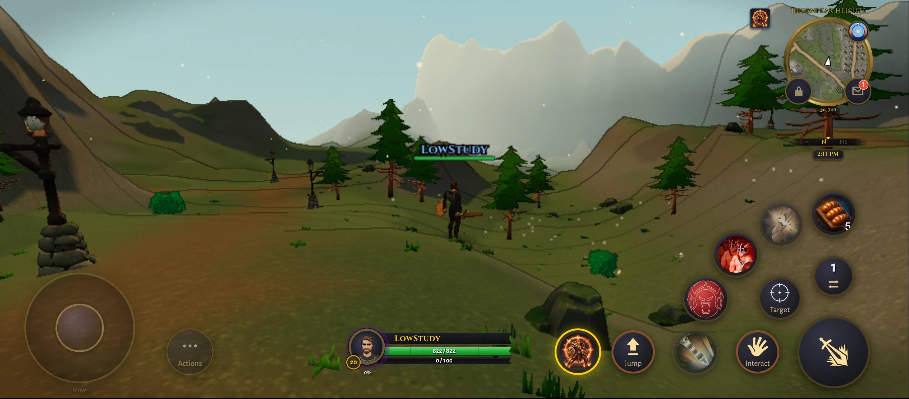

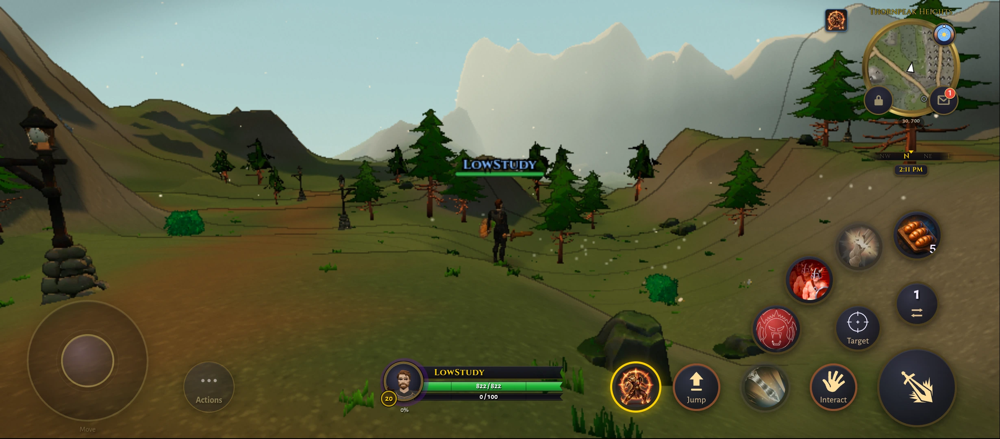

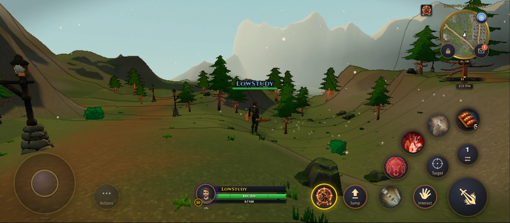

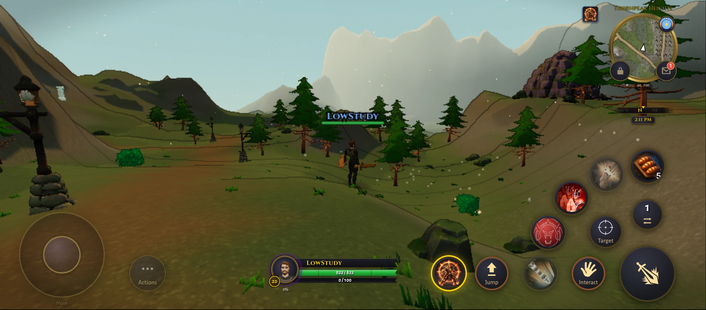

### Phone, Palmreach

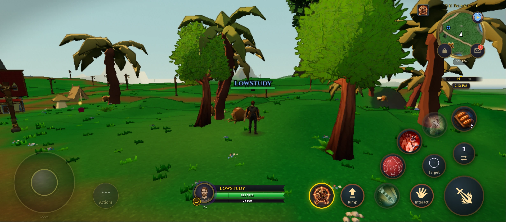

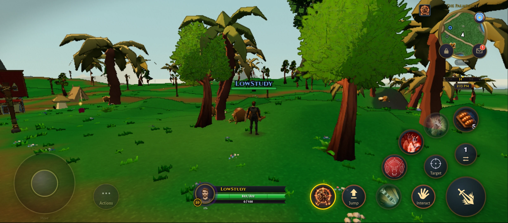

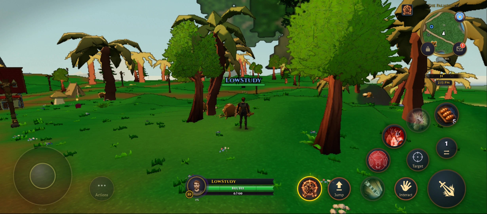

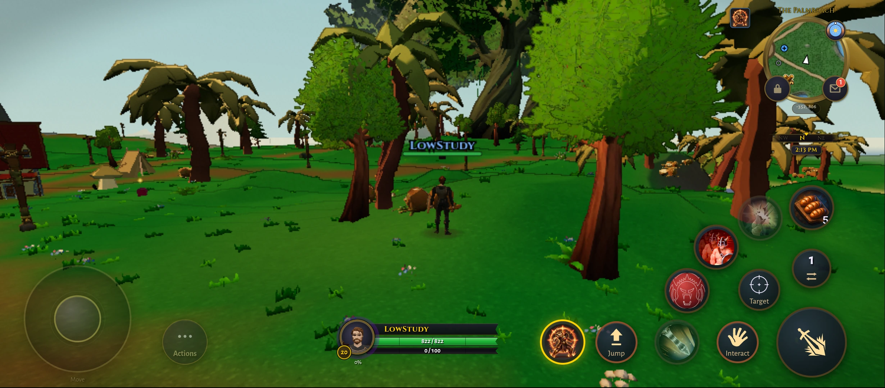

### Mac, Thornpeak

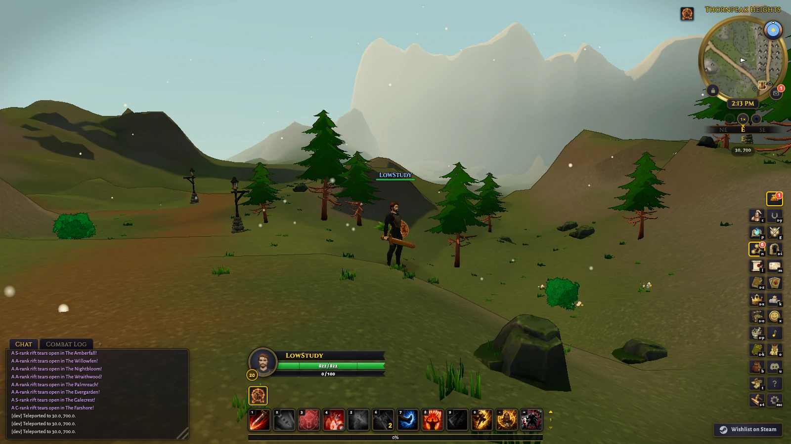

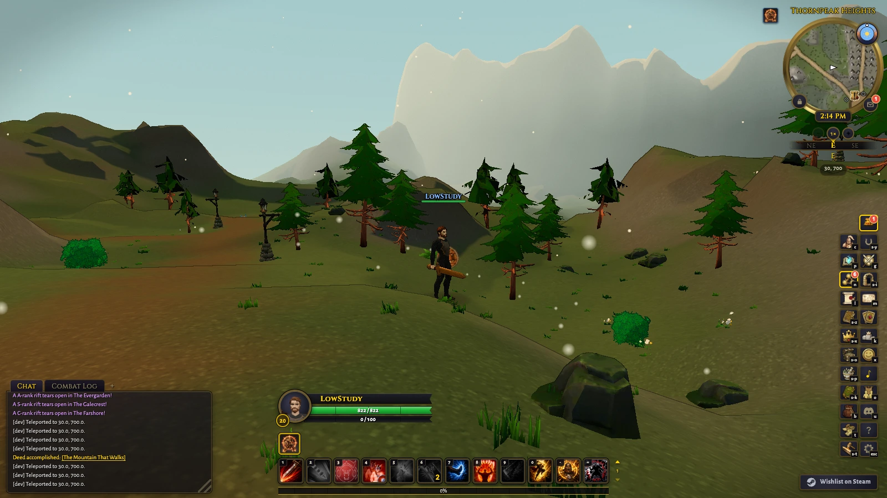

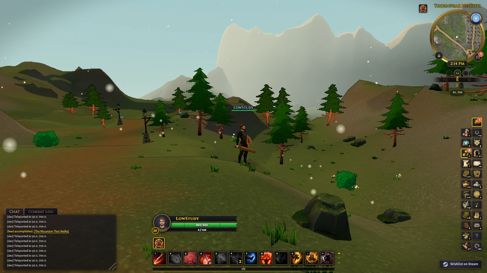

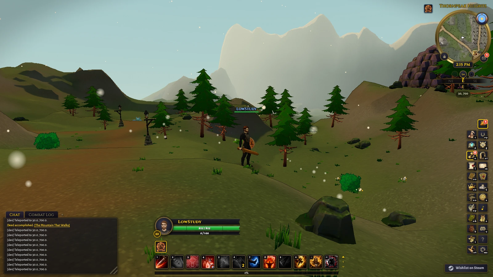

### Mac, Palmreach

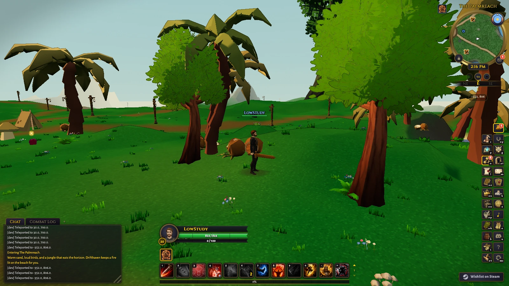

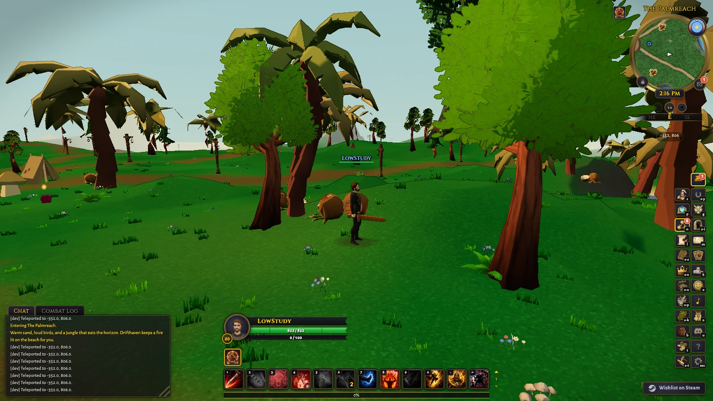

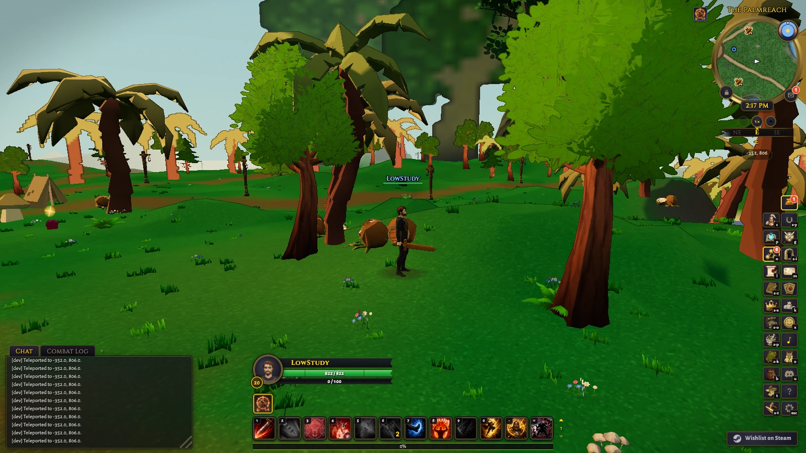

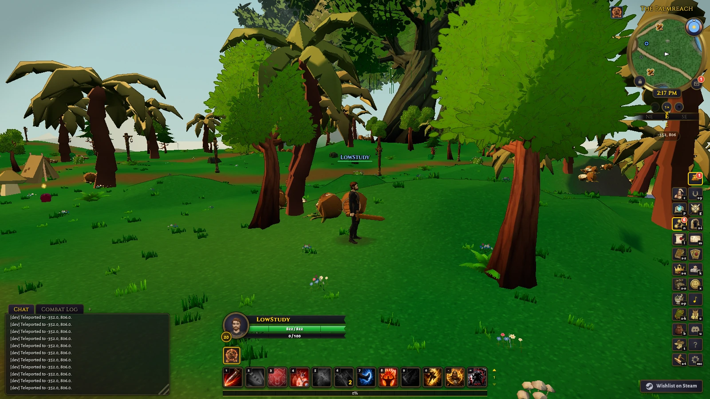
