# Low scenery quality, horizon and Palmreach tree experiment

Historical local R&D on 14 October 2026. No shipping defaults changed.

Use separate regional tree budgets as a candidate, but do not claim a new FPS win. Fuller middle-distance trees improve Thornpeak pine silhouettes. In Palmreach, the regional reduction cuts the timed middle layer from 131,083 to 39,051 triangles while keeping near trees unchanged. Redmi fuller-horizon to regional is 28.05 to 29.06 FPS forward and 27.80 to 30.22 reverse; neither improvement clears the roughly 10 percent noise reference. The prior 240-yard setup remains faster at 31.78 and 30.85 FPS. Mac regional pairs are 86.05 to 80.15 and 92.30 to 88.49 FPS against that prior setup: small costs, no demonstrated speed gain. Keep the stronger Palmreach option for visual selection, but stop this experiment rather than expanding it to force a win. No shipping preset or 60 FPS result is established.

## Fuller trees and extended horizon

### Redmi

| Scene | Order | Previous 240-yard setup FPS | Fuller 60 to 120-yard trees FPS | Fuller trees + horizon/sprites FPS |
| --- | --- | --- | --- | --- |
| beach | forward | 31.39 | 27.55 | 27.74 |
| beach | reverse | 30.61 | 27.71 | 27.71 |
| thornpeak | forward | 42.83 | 41.08 | 39.26 |
| thornpeak | reverse | 42.87 | 41.11 | 38.34 |

### Mac

| Scene | Browser order | Candidate | Baseline FPS | Candidate FPS |
| --- | --- | --- | --- | --- |
| beach | forward | Fuller 60 to 120-yard trees | 111.85 | 110.14 |
| beach | forward | Fuller trees + horizon/sprites | 110.73 | 104.87 |
| beach | reverse | Fuller 60 to 120-yard trees | 101.71 | 104.17 |
| beach | reverse | Fuller trees + horizon/sprites | 106.66 | 103.41 |
| thornpeak | forward | Fuller 60 to 120-yard trees | 112.68 | 113.42 |
| thornpeak | forward | Fuller trees + horizon/sprites | 80.84 | 76.52 |
| thornpeak | reverse | Fuller 60 to 120-yard trees | 110.70 | 111.57 |
| thornpeak | reverse | Fuller trees + horizon/sprites | 110.17 | 104.58 |

## Palmreach-specific reduction

### Redmi

| Scene | Order | Previous 240-yard setup FPS | Fuller trees + horizon/sprites FPS | Horizon + cheaper Palmreach trees FPS |
| --- | --- | --- | --- | --- |
| beach | forward | 31.78 | 28.05 | 29.06 |
| beach | reverse | 30.85 | 27.80 | 30.22 |

### Mac

| Scene | Browser order | Candidate | Baseline FPS | Candidate FPS |
| --- | --- | --- | --- | --- |
| beach | forward | Fuller trees + horizon/sprites | 65.75 | 62.32 |
| beach | forward | Horizon + cheaper Palmreach trees | 86.05 | 80.15 |
| beach | reverse | Fuller trees + horizon/sprites | 83.68 | 79.36 |
| beach | reverse | Horizon + cheaper Palmreach trees | 92.30 | 88.49 |

## Method

Compare within each row only. The baseline is the previous 60-yard full-detail budget with simple geometry to 240 yards, not stock Low. Phone tests each setting twice (two 20-second windows), then reverses setting order. Mac uses two simultaneous uncapped ANGLE Metal targets and reverses browser launch and candidate order; each pair has two 20-second windows. Uptime is recorded before runs. Low, three-band cel, fixed noon, FXAA off, governor off; buffers remain 899 by 394 on Redmi and 1600 by 900 on Mac. The minified game build is unchanged. These are warm throughput measurements, not display smoothness or startup measurements. Other user work remained active on the Mac. The approximate 10 percent noise reference is a screening rule, not a statistical confidence interval.

The original Mac reverse run was resized during sampling. Rejected windows are retained. Only its earlier clean Thornpeak horizon pair is accepted; the remaining reverse pairs were freshly prepared and measured in mac-resume.json. Compare pairs within their own run, never absolute FPS across runs. A prior disk-full attempt has no accepted comparison and remains archived.

## Visual judgement

The fuller middle-distance models restore coherent pine crowns in Thornpeak. Palmreach can tolerate stronger reduction as a prototype: nearby trees retain their forms and background palms remain recognizable, though their crowns are thinner. The inspected approach/retreat/orbit frames keep near trees present; this is bounded visual evidence, not complete gameplay or transition certification.

The combined horizon treatment should not ship. Giant sprites become conspicuous pale, flat silhouettes through Thornpeak fog. Palmreach giants look more coherent at the tested noon view, but four-view changes and hard near-model handoffs remain. Automatic outer reduction still leaves detached-looking canopy fragments. The next visual work is connected cheap canopy shapes and a better giant-sprite atmospheric fade, not more distance bands. Ground presentation and dark character clothing remain unresolved.

## Matched wide screenshots

### phone, thornpeak

| Previous 240-yard setup | Fuller 60 to 120-yard trees | Fuller trees + horizon/sprites |
| --- | --- | --- |
| 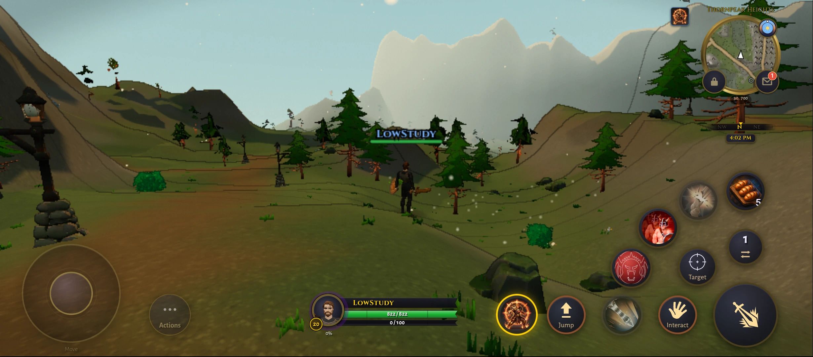 | 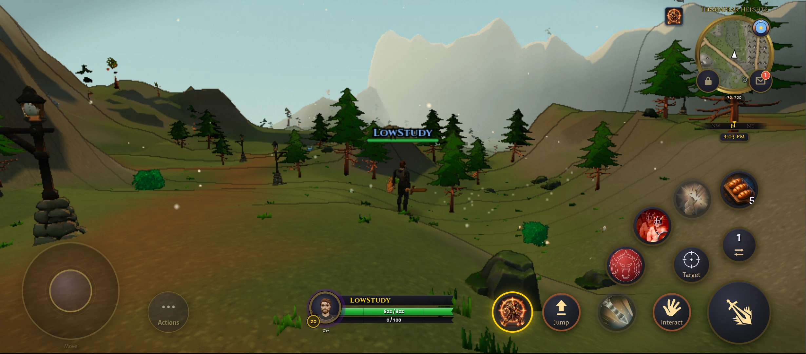 | 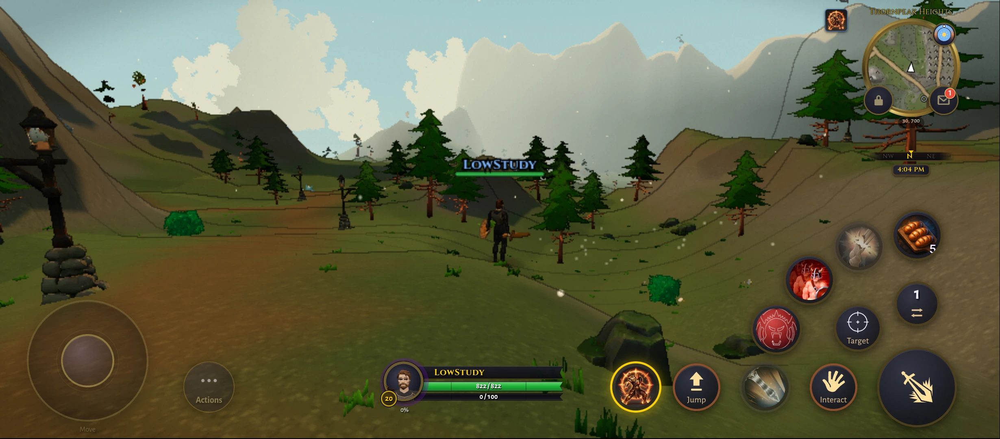 |

### phone, beach

| Previous 240-yard setup | Fuller trees + horizon/sprites | Horizon + cheaper Palmreach trees |
| --- | --- | --- |
| 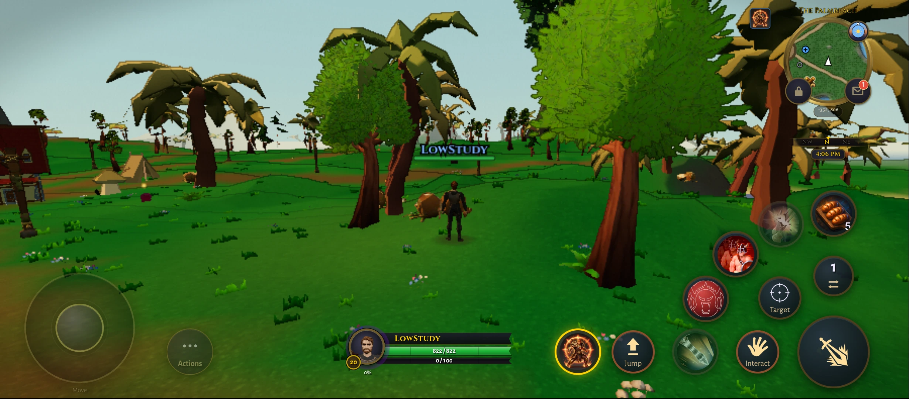 | 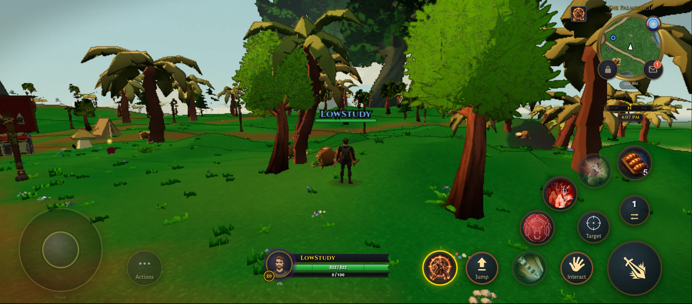 | 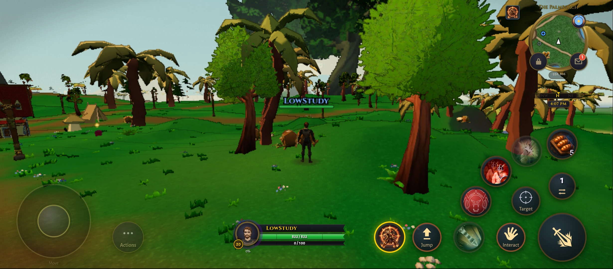 |

### mac, thornpeak

| Previous 240-yard setup | Fuller 60 to 120-yard trees | Fuller trees + horizon/sprites |
| --- | --- | --- |
| 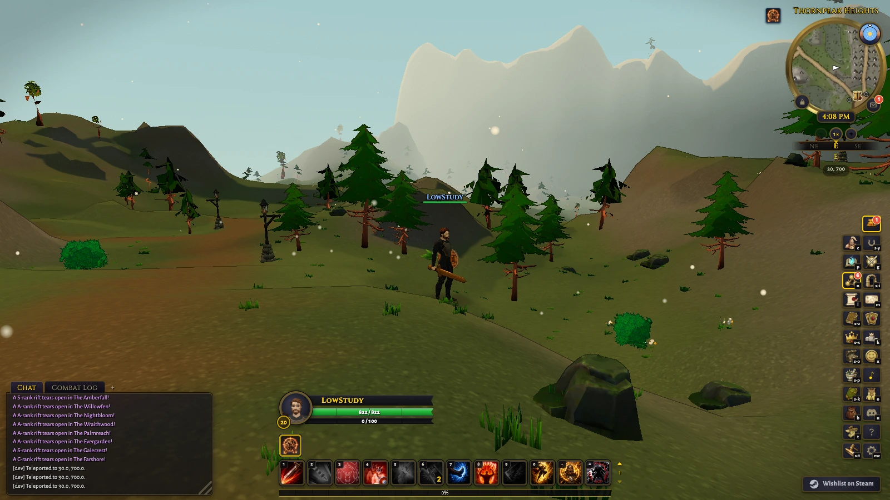 | 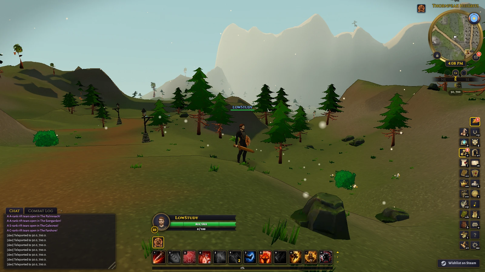 | 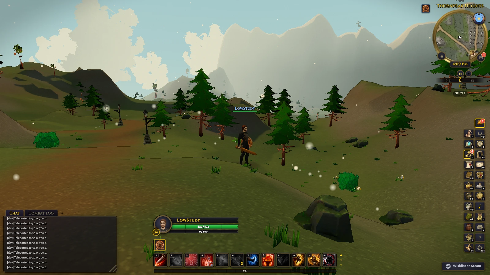 |

### mac, beach

| Previous 240-yard setup | Fuller trees + horizon/sprites | Horizon + cheaper Palmreach trees |
| --- | --- | --- |
| 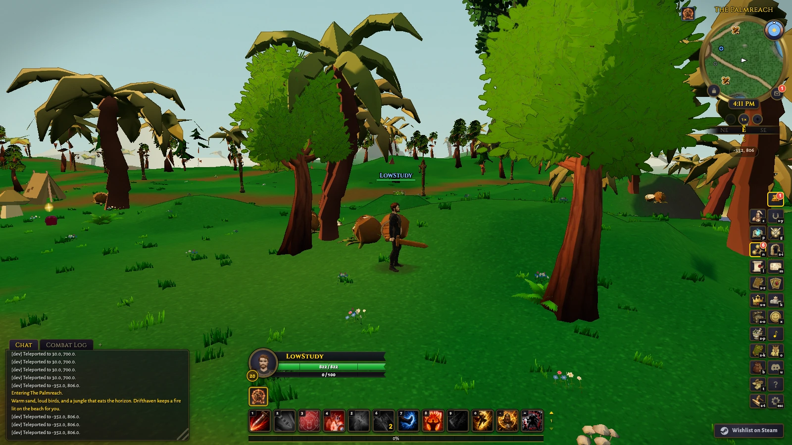 | 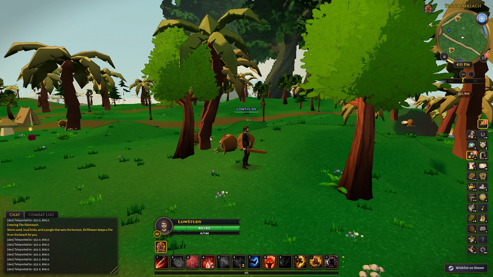 |  |

## Implementation and limits

Standard middle quality targets 512 triangles per source part with an approximate 1% simplification error limit, retaining more when necessary. Palmreach regional mode targets 256 with permissive 3% reduction, then allows coarse topology reduction if more than twice the target remains. It selects trees by their placement inside the authored Palmreach rectangle and by asset family. Other zones retain standard quality; near scenery, terrain geometry, actors, materials, textures and collision remain unchanged.

Horizon adds 12-triangle-target geometry from 240 to 480 yards, with a fog tail to 560. Giant Evergarden/Palmreach trees use four baked yaw views, 256-pixel cells, after their whole footprint leaves the near 64-yard margin; other proxy bands exclude the same giants. Fog preserves stronger native haze: near=min(native,320), far=min(native,560). It affects distant terrain and actors as well as scenery, so gameplay visibility still needs broader testing.

This is a bounded prototype, not a shipping preset. Bands use horizontal origin/footprint distances while standard fog uses view depth; off-axis popping remains possible. Sprite view changes and near-model handoffs are abrupt. Sprite light is baked at noon and has no day/night grading. Collection is fixed around each test scene, not streamed. Towns and other realm families are not covered. All arms retain all prototype geometry and atlas allocations; giant color atlases alone cost 12 to 16 MiB, plus depth/driver overhead and existing unused middle atlases. No memory, cold-entry, sustained-combat, Windows/iPhone or phone 60 FPS claim is made.

## Verification

PASS: npx vitest run tests/scenery_quality_indices.test.ts tests/scenery_quality_experiment.test.ts tests/middle_band_experiment.test.ts tests/far_band_experiment.test.ts tests/scenery_distance_experiment.test.ts (25 tests, 5 suites).
PASS: npx tsc --noEmit.
PASS: scoped npx @biomejs/biome check over the 13 task source/declaration/test files; test non-null assertion warnings remain.
PASS: npx esbuild tmp/palm-budget/entry.mjs --bundle --format=iife --platform=browser --outfile=tmp/palm-budget/inject.js, exercised on the actual devices over the unchanged minified game build.
PASS: python3 tmp/scenery-quality/accept-final.py and python3 tmp/palm-budget/accept.py: 84 accepted windows; five excluded Mac blocks retained in the initial study, no follow-up exclusions.
PASS: bounded GPU/resource/region-selection review; no outstanding ownership defect.
Source provenance: exact timed controllers and bundle retained. Post-timing edits are comments/formatting and a preparation-only Map initialization split required by lint; node tmp/palm-budget/source_equivalence.mjs verifies the normalized comparison. No timed per-frame code changed.
BLOCKED by existing branch errors: node scripts/gate_select.mjs passes artifact freshness and security, then fails on src/sim/content/pvp_honor.ts formatting and tests/static_instance_cells.test.ts callback return. Later broad tests/browser/build steps were not reached. No merge-readiness claim.
PASS: python3 tmp/palm-budget/visual_accept.py: 24 fixed-buffer matched stills, six phone videos, twelve bounded routes and no audited nearby-placement omissions. Phone routes covered about 35 yards in Thornpeak and 18 in Palmreach from the first sample; Mac about 24 and 35.
PASS: node tmp/palm-budget/report_check.mjs: all comparison selectors/images load, eighteen result rows, six video links, no script errors or desktop/mobile overflow.

The controller is `scripts/lib/scenery_quality_experiment.mjs`; geometry policy is `scripts/lib/scenery_quality_indices.mjs`. Direct tests cover region/family selection, shared-geometry cache isolation, source immutability, mode ownership, near restoration, fog exception restoration and rollback. Local raw evidence, exact timed source copies and videos live in `tmp/scenery-quality` and `tmp/palm-budget`; open `tmp/palm-budget/report.html` for matched gameplay/wide cameras. Ignored raw artifacts are not present in a fresh clone. No push, merge or deployment. Phone wake ownership remains active.
