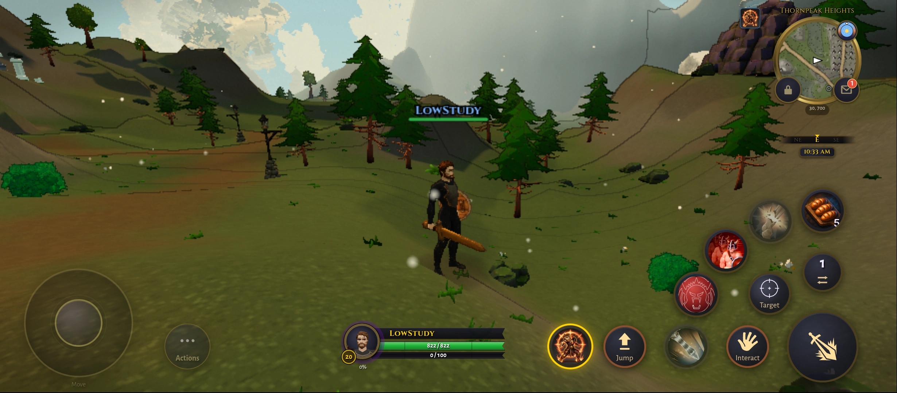
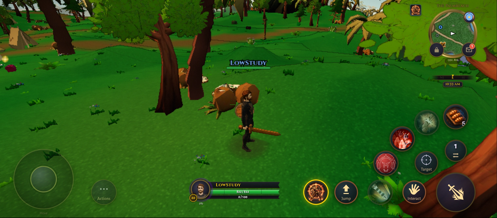
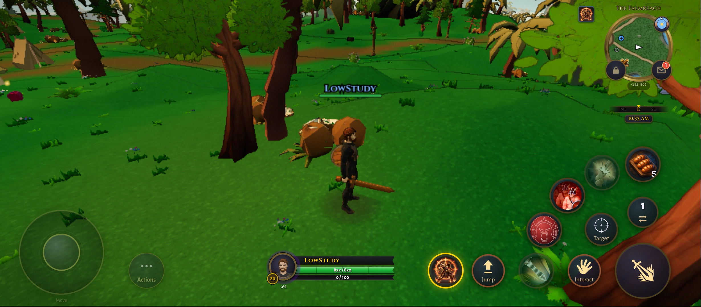
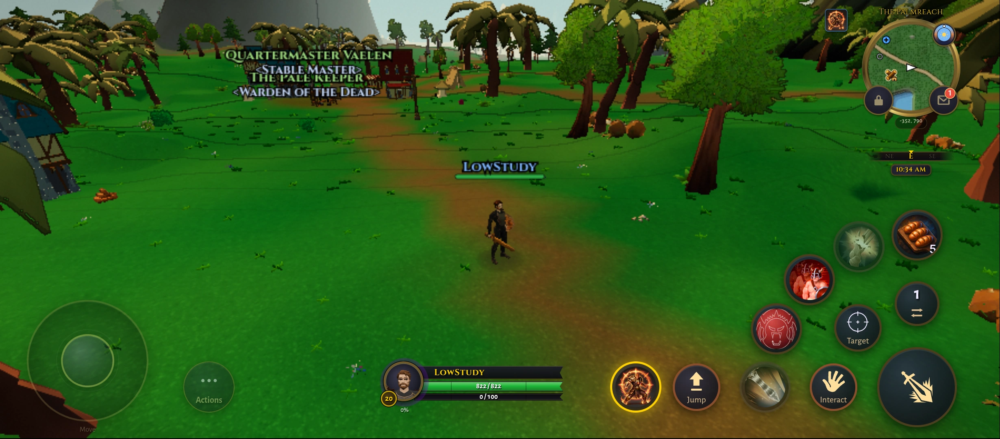
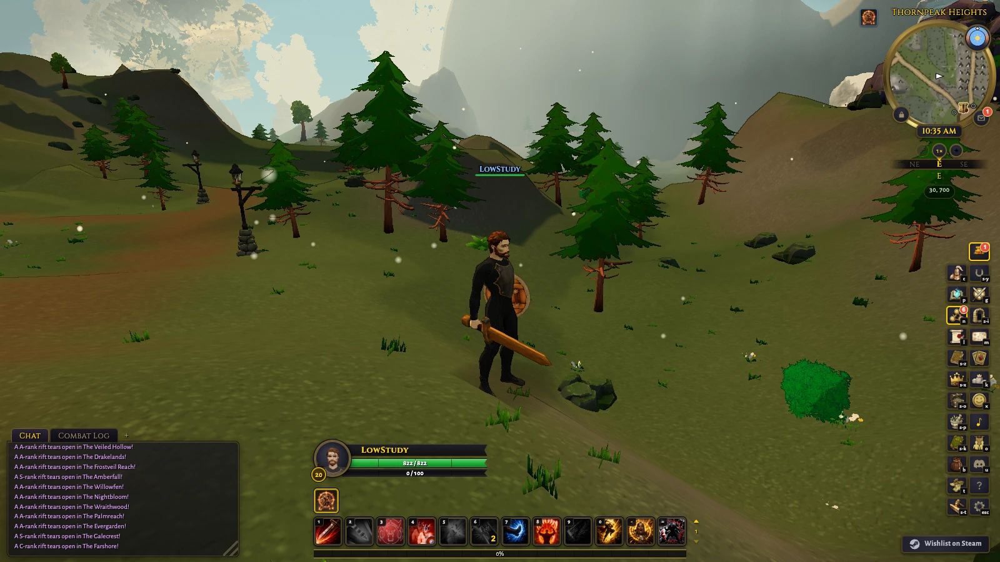
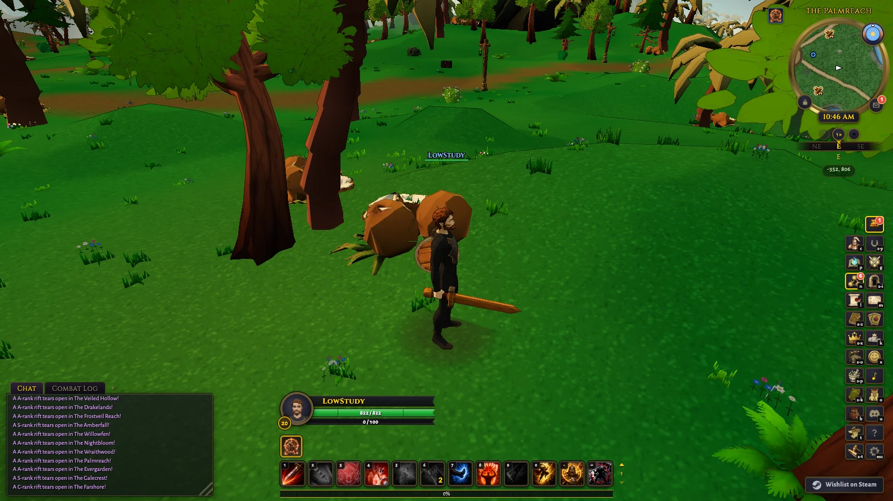

# Low scenery spatial grouping: bounded experiment

Research record, 14 October 2026, on `feature/cel-shading-rnd`, starting at
`f6371e07b29`. No production source or shipping defaults changed. This follows
[Low scenery R&D](low-scenery-rnd.md) and the inconclusive
[distant-tree sprite experiment](distant-tree-sprite-rnd.md).

Follow-up: [constructor-time coconut integration](coconut-cell-integration.md)
records the production-path implementation and its separate measurements.

## Decision

Keep spatial grouping as a specific Low development candidate. Redmi Thornpeak improves
from 19.10 to 22.21 FPS and from 19.30 to 22.39 FPS in reversed order, with full model
detail and unchanged view distance. Both gains exceed the roughly 10 percent noise
reference; the 23 FPS experiment target and 60 FPS goal remain unmet.

Close beach phone changes are within noise. Mac Thornpeak changes are also within noise,
while the close beach is 2.13 and 3.58 FPS slower in the two orders, also below that
threshold. This is not a proven desktop speed gain or a guarantee of zero regression.
More visible cells add draw calls.

The inspected stills and sampled movement retain the scenery. Production integration
should create the cells before preparation/shadow inventories and evaluate the draw-call
tradeoff. No production source or shipping defaults changed in this experiment.

## Selection and implementation

The current Low submitted-draw census found fallen coconuts as the largest
individual draw in the Thornpeak phone scene: 324 instances times 1,186
triangles, or 384,264 triangles. The original `jungle-features` instance batch
covers the strand. At this camera it submits all instances even though no
individual coconut group is visible.

A conservative geometry LOD screen retained the coconut geometry under its
shape-error bound. It saved only about 89,000 triangles in other selected bark,
so the incomplete pilot was stopped and excluded from final performance claims.
Aggressive simplification was not adopted to force the target.

The selected prototype partitions ONLY the static coconut batch into forty
64-yard groups. Each uses the original geometry and material, the exact instance
matrices, the same parent transform and computed full-geometry bounds. Ordinary
Three.js frustum rejection now skips offscreen groups. There is no shorter view
distance, cheaper model, sprite, altered lighting or collision change. Nearby
and distant coconuts retain their full original detail.

This fills a specific gap in the existing culling: `src/render/jungle_features.ts`
uses one instance batch per prop part, while the existing zone-feature sweep
operates on larger roots. Tree buckets and other existing culling systems are
not replaced. The earlier Matt PR inventory remains context; this work does not
port or duplicate his shader-preparation or memory fixes.

## Method and FPS

Fixed Low, three-band cel, noon, fixed camera and quality, governor off. Phone:
Redmi 12 5G, 899 by 394 drawing buffer / 894 by 392 CSS, scale 0.68, uncapped
intent, single-page ABBA then BAAB, two 20-second windows per setting/order.
Mac: two simultaneous uncapped Metal browser targets, 1600 by 900 at DPR 1,
three 20-second windows per setting, then reverse launch order. Uptime is recorded
before each run. Compare within each row only; values are submitted frames over
elapsed time. All accepted windows must preserve quality/buffer and execute no
recorded preparation, pending tails or program-count changes.

Both arms use the identified minified sprite-v4 research build with sprites OFF.
Both retain its atlas/material clones and the new cell objects; OFF hides the
cells and restores the original. These are controlled rendering comparisons,
not memory measurements against an untouched process. The partition runs once
before settling, with no extra frame-loop callback. Visible cell-buffer uploads
are warmed before near-view timing.

| Device, scene, order | Current Low FPS | Spatial groups FPS |
| --- | ---: | ---: |
| M4 Pro, Palmreach close view, candidate-first | 142.44 | 138.86 |
| M4 Pro, Palmreach close view, stock-first | 152.39 | 150.26 |
| M4 Pro, Thornpeak, candidate-first | 122.20 | 124.35 |
| M4 Pro, Thornpeak, stock-first | 133.24 | 138.79 |
| Redmi, Palmreach close view, ABBA | 18.96 | 19.35 |
| Redmi, Palmreach close view, BAAB | 18.95 | 19.12 |
| Redmi, Thornpeak, ABBA | 19.10 | 22.21 |
| Redmi, Thornpeak, BAAB | 19.30 | 22.39 |

At Thornpeak, phone submissions fall from 2,557,629 to 2,173,365 triangles and
559 to 558 draws. At the close beach camera, triangles fall from 2,443,585 to
2,387,843 but draws rise from 344 to about 375: only 47 coconut instances are
rejected. The near view tests the extra-draw tradeoff instead of assuming every
camera benefits equally. Neither phone beach order establishes a useful gain.

In the narrower Mac Thornpeak view, total submissions remain approximately
2.064 million triangles in both states. There is no measured geometry saving
there, and the small FPS differences do not establish a desktop speed gain.

Initial beach v1 and Mac v1 runs were stopped for late preparation/program work
and are excluded. Mac v2 retains excluded windows and restarts its three-window
block after preparation. Paired desktop rates vary substantially across windows;
do not interpret their absolute FPS across runs or claim normal-vsync smoothness.

## Visual, lifecycle and verification

Inspected phone close/wide pairs retain the same coconut clusters, tree shapes
and ground detail. Wind, particles and patrols can differ between screenshots.
A short continuous approach/retreat moved about 42 yards forward and 28 back,
then orbited; inspected sampled frames show no obvious missing coconut groups.
This is bounded visual evidence, not certification of every world view. Character
darkness and jagged mobile detail remain; this experiment does not alter them.

All placements are represented exactly once. Focused tests check negative and
positive cell boundaries, exact matrices, full geometry bounds, shared material
and geometry identity, OFF restoration, cleanup and rejection of unsupported
per-instance color/morph/custom attributes. After phone cleanup there were zero
cell meshes, no prototype state, the original 324 instances submitted again,
and the browser wake lock remained held. No new RAF loop exists to leak.

Scoped GPU review found no blocker for Low with shadows disabled, confirmed on
both devices. A production implementation must partition during construction,
before preparation and shadow-caster inventories are captured. Injecting cells
later would miss the sweep's shadow inventory on a shadows-enabled profile; this
experiment does not validate those profiles.

Commands: `node --test tmp/mid-scenery/spatial_prototype.test.mjs` (three passed),
`node tmp/mid-scenery/spatial_census.mjs`, the `phone_spatial_*` and
`bench_mac_spatial*_v2.mjs` drivers, and `visual_phone_spatial.mjs`. Source/build
hashes, exact run files, excluded attempts and the motion clip are retained under
`tmp/mid-scenery/`; local report `tmp/mid-scenery/report.html`.
These scripts, tests, raw JSON and video are ignored local artifacts, unavailable
in a fresh clone. The committed record and ten WebPs preserve the findings;
the listed commands require the local research workspace.

This documentation-only evidence commit does not clear the existing branch merge
gate. Existing offline API 502s and unavailable training-dummy/druid-staff visuals
limit scene coverage. No Windows, iPhone, online raid or whole-world performance
claim is made. The prototype is OFF and cleaned up; phone wake protection remains
active. Nothing was pushed, merged or deployed.

## Matched pictures

| Scene | Current Low | Spatial groups |
| --- | --- | --- |
| Redmi Thornpeak |  |  |
| Redmi close beach |  |  |
| Redmi wider beach |  |  |
| Mac Thornpeak |  |  |
| Mac beach |  |  |
