# Laverock's walk and the Sunken Bastion rain

Before is the integration head `a4cce65bca`; after is `fix/laverock-walk-bastion-rain-v045`.
Both ran the offline client on the Ultra preset at 1600x900 with a real GPU backend
(`--use-angle=d3d11`), captured with puppeteer and resized to 1280 wide.

## Laverock following the group (Drowned Temple)

The guide keeps his body, textures, idle, gestures and song. A sibling animation bank on his
own skeleton replaces Walk and adds Run, and the manifest now matches both to the sim's
follow speeds (`CANTOR_GUIDE.follow`: 3.2 yd/s walking, 7 yd/s catching up).

Measured in the running game on the flat colonnade, sampling his foot bones every rendered
frame while he trailed a scripted player:

| Phase | Build | Clip playing | Clip rate | Body speed | Stance foot slide |
| --- | --- | --- | --- | --- | --- |
| Follow | before | Walk | 2.56x | 3.2 yd/s | 0.05 yd/s |
| Follow | after | Walk | 1.73x | 3.2 yd/s | 0.00 yd/s |
| Catch up | before | Walk | 3.60x (capped) | 7.0 yd/s | 2.56 yd/s |
| Catch up | after | Run | 1.57x | 7.0 yd/s | 0.02 yd/s |

Before, the catch-up was the walk cycle sped to its cap with the feet skating under him.
After, he strides at a calmer cadence and breaks into a real run with the staff lifted.

| | Before | After |
| --- | --- | --- |
| Follow | 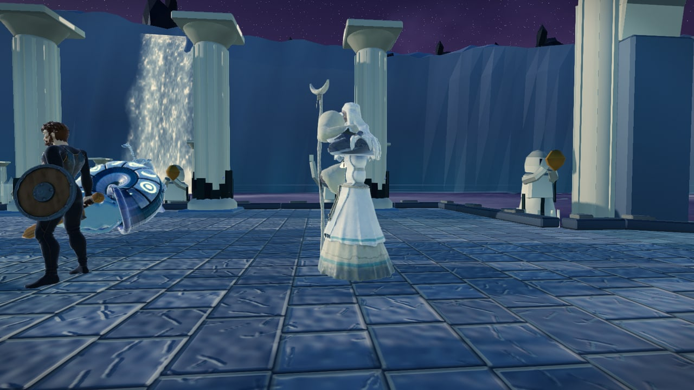 | 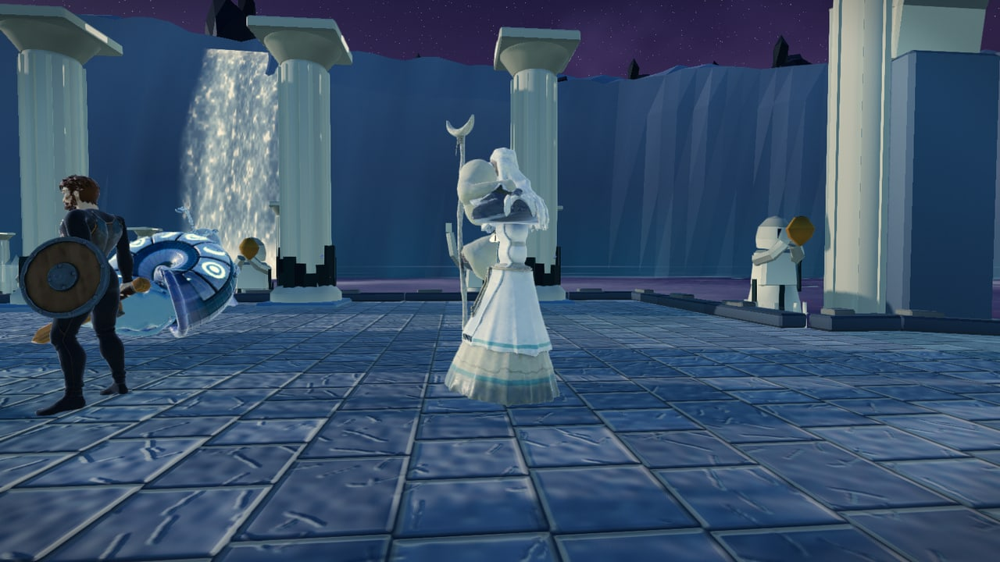 |
| Catch up | 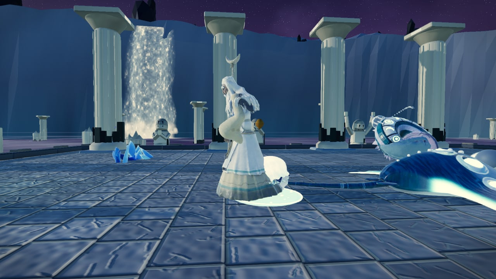 | 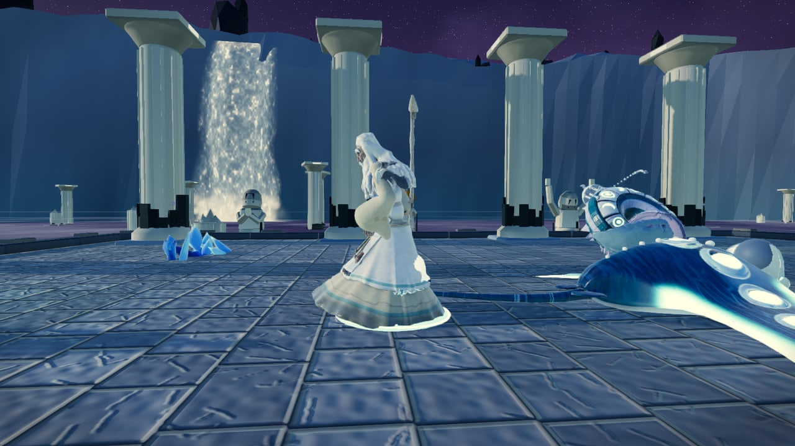 |

His robe covers the feet in a still, so the table above is the evidence for the gait; the
stills show the pose (the catch-up frame is the old shuffle against the new run).

## Rain splashes on the Bastion floor

Each strip is the same moment twice: the splash clock is frozen and the camera yaw is nudged
by 0.05 rad between the left and the right half. Before, the ripple rings are placed
relative to the camera, so the whole pattern jumps to new spots on the stone. After, the
rings sit on a ground-anchored lattice and stay where they landed.

| Before | After |
| --- | --- |
| 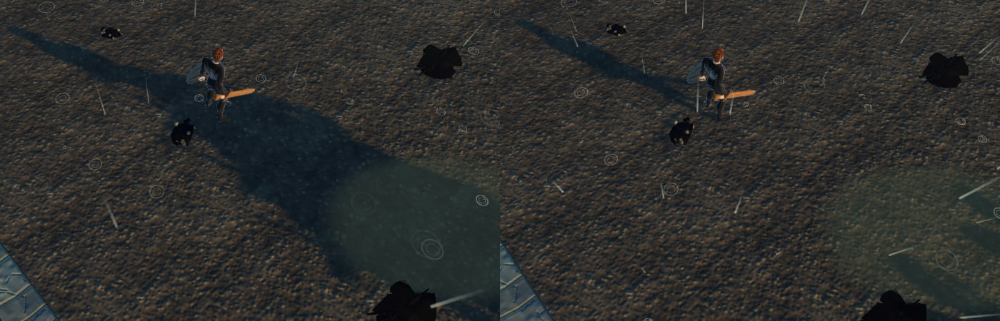 | 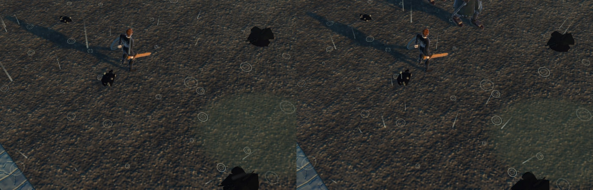 |

A ground-anchored lattice repeats on the floor, so it must leave nothing dry: every cell
holds a splash and a splash lands anywhere in its cell, edge to edge. Below, the splashes
alone, straight down, with 48 frames over about eight seconds blended to their brightest:
an even field with no dry stripe and no grid, fading only with distance from the camera.

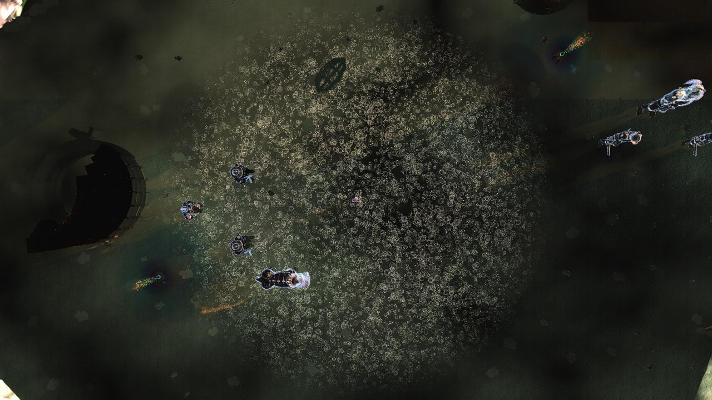

From a high chase camera, in one frame:

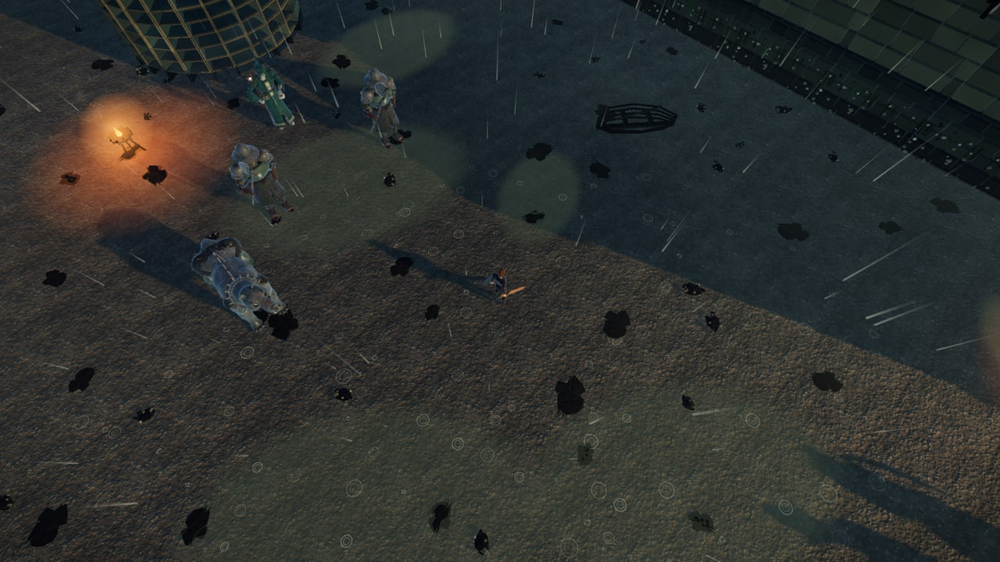

The storm itself is unchanged (same three draws, same streak, splash and sheet counts):

| Before | After |
| --- | --- |
| 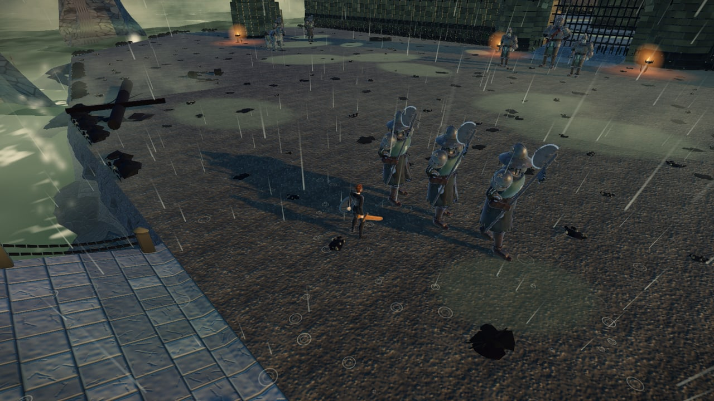 | 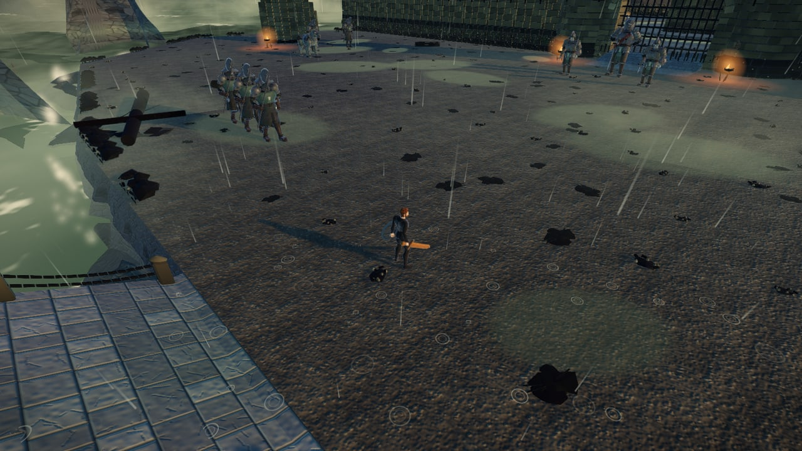 |

## Rain after leaving the Bastion

The original batch also stopped the retained storm from following the player out of the
dungeon. The integration already does that for every open-air field
(`src/render/open_air_field_visibility_core.ts`), so that part was not ported. Both builds
show no Bastion rain in Thornpeak after a Bastion visit (the drifting motes are Thornpeak's
own snow):

| Before | After |
| --- | --- |
| 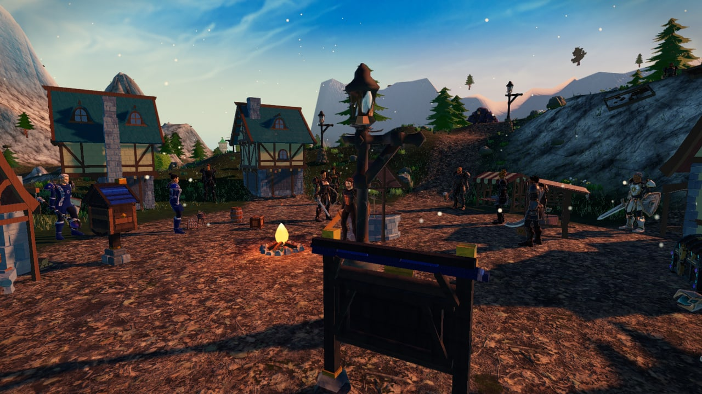 | 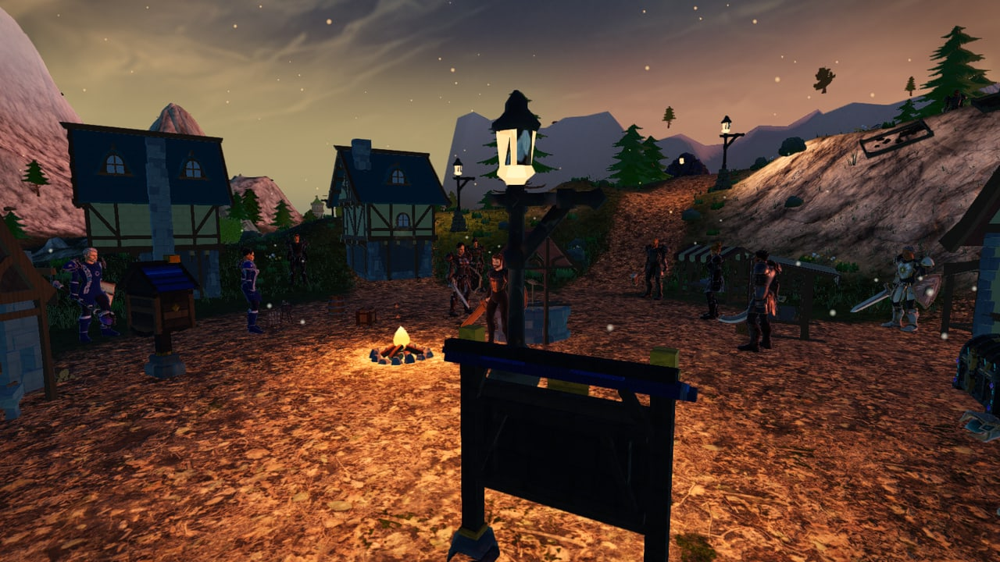 |
